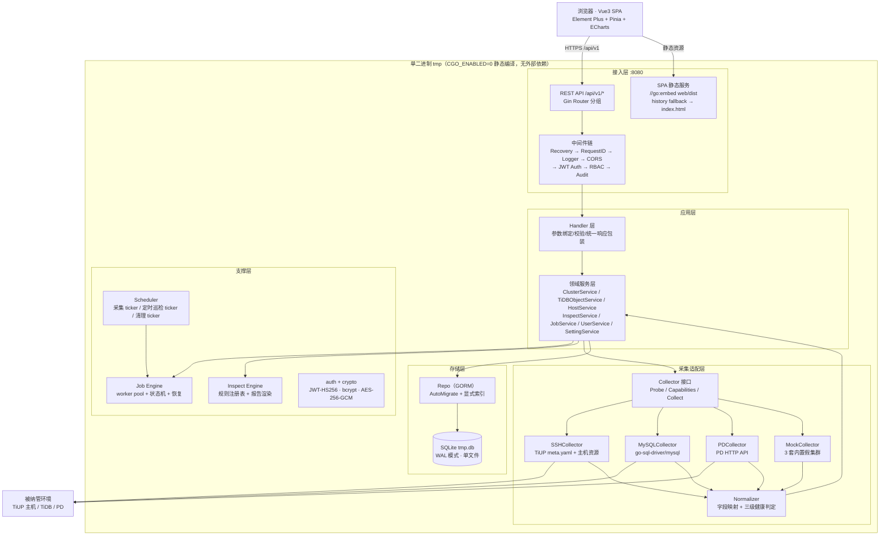
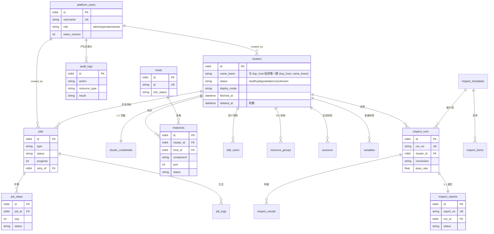
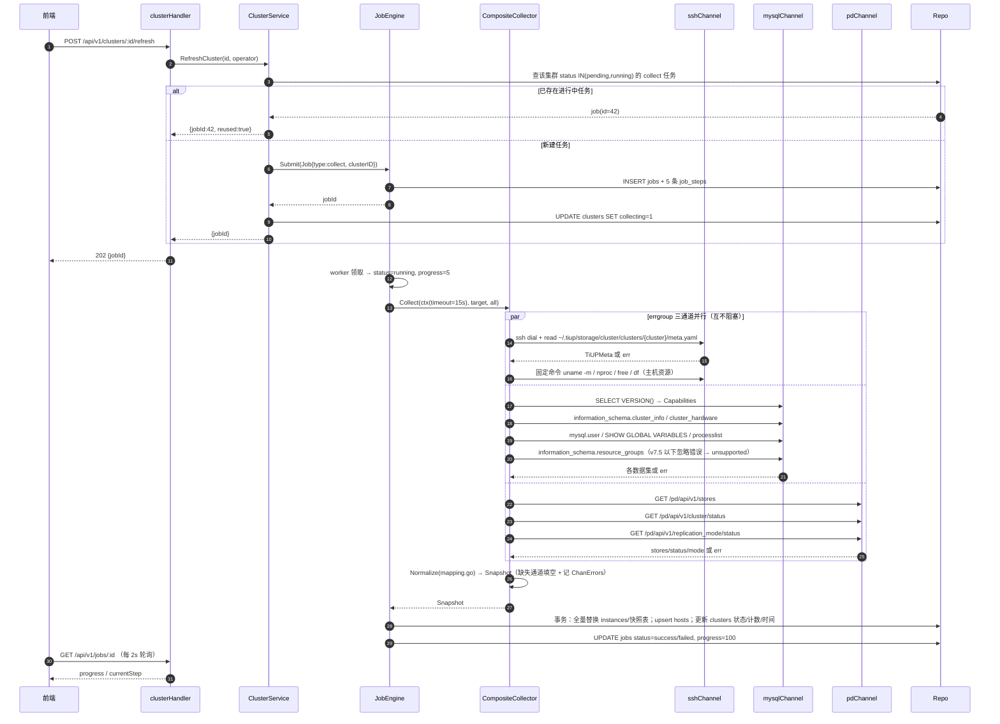
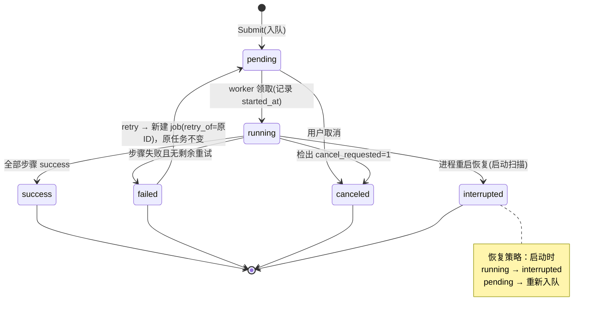
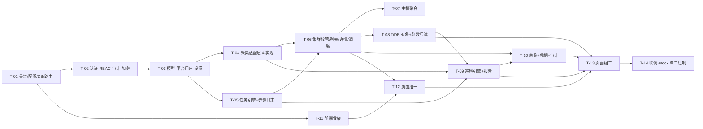

# TMP（TiDB Manage Platform）系统架构设计

| 项目 | 内容 |
| --- | --- |
| 文档版本 | v1.0 |
| 日期 | 2026-11-20 |
| 作者 | 高见远（架构师） |
| 上游输入 | `docs/PRD.md` v1.0（F-01 ~ F-71，P0 36 条） |
| 下游消费者 | 工程师（据此编码）、QA（据此验收） |
| 交付形态 | 单二进制 + 单 SQLite 文件，零外部中间件 |

---

## 1. 架构总览

### 1.1 一句话架构

**一个 Go 二进制内含「Gin REST API + 嵌入式 Vue SPA + 可插拔三通道采集器 + 进程内异步任务引擎」，元数据落单文件 SQLite，凭据 AES-256-GCM 加密，通过 collector 接口在真实集群与 mock 数据源之间无缝切换。**

### 1.2 已定决策（不可推翻，实现时必须遵守）

| # | 决策 | 落地含义 |
| --- | --- | --- |
| D-1 | **F-43 参数修改不进 MVP** | MVP 只提供 F-42 只读查看；`PUT variables` 留接口位但标记 P1，且必须走白名单（仅允许 `max_connections` / `oom-action` / `tidb_mem_quota_query` / `tidb_distsql_scan_concurrency` / `log_slow_query_threshold` 等有限集合），未白名单直接 40301 |
| D-2 | **不做集群级数据权限** | 权限模型 = 角色（admin / operator / viewer）× 操作。所有登录用户可见全部集群。审计表保留 `resource_id` 供未来升级 |
| D-3 | **巡检项用内置可扩展规则** | 6 大类 20+ 项，规则以 YAML 内嵌（`internal/inspect/templates/*.yaml`）+ 代码内建判定函数注册表实现，不做可视化规则编辑器 |
| D-4 | **定时巡检用进程内 ticker** | 复用采集调度器的 ticker 循环，不引入 cron 库、不引入外部调度；F-53 归 P2 |
| D-5 | **数据保留** | 任务（jobs/job_steps/job_logs）30 天、审计 `audit_logs` 180 天、巡检报告永久。进程内每日清理 goroutine 执行，保留期可从 settings 覆盖 |
| D-6 | **版本兼容靠能力探测** | 支持 TiDB 6.5 / 7.1 / 7.5 / 8.5。启动采集时 `Capabilities()` 探测（`SELECT VERSION()` + 试探 `information_schema.resource_groups`），结果驱动 UI 显隐；低版本访问不支持能力返回 **409 + 40901** 且 message 明确（如「当前 TiDB v6.5.4 不支持 Resource Group，需 v7.5.0+」） |
| D-7 | **mock 优先于真实采集落地** | mock collector 必须先于真实采集可用，保证无集群环境也能完整验收 P0 流程 |

### 1.3 已收口的 PRD 待确认项

| PRD 编号 | 结论 |
| --- | --- |
| Q1 凭据维护 | 接管时 DBA 自填，落 `cluster_credentials`（1 集群 1 份）；F-66「凭据管理」页按集群列出并支持更新/测试；仅 admin 可改 |
| Q2 草稿 | 允许仅保存草稿（`clusters.draft=1`），草稿不计入「纳管集群数」与「异常集群数」 |
| Q3 参数修改 | 见 D-1 |
| Q4 巡检项 | 见 D-3，内置 6 类 24 项起步 |
| Q5 告警 | MVP 仅跳转 Grafana，不接 Alertmanager API；F-32 归 P2 |
| Q6 定时巡检 | P2，进程内 ticker |
| Q7 数据权限 | 见 D-2 |
| Q8 保留期 | 见 D-5 |

### 1.4 分层架构图



**单二进制边界**：`LA / LB / LC / LD / LE` 全部编译进同一可执行文件；外部只依赖被纳管环境网络可达。运行时产物仅 `tmp.db`（+ WAL/SHM）、`data/secret.key`（未设 `TMP_SECRET` 时自动生成）、日志目录。

---

## 2. 技术选型与理由

### 2.1 后端 Go 依赖（`go.mod`，均可在国内网络 `go mod download` 成功）

| 组件 | 选型 | 版本 | 理由 | 替代方案 |
| --- | --- | --- | --- | --- |
| 语言 | Go | 1.22 | 已定；`//go:embed` 与 `errgroup` 成熟 | — |
| HTTP 框架 | `github.com/gin-gonic/gin` | v1.10.0 | 已定；路由分组/中间件/`StaticFS` 满足 SPA 托管 | echo、chi |
| ORM | `gorm.io/gorm` | v1.25.12 | 已定；`AutoMigrate` 免手写迁移 | sqlx + 手写 DDL |
| SQLite 驱动 | `github.com/glebarez/sqlite` | v1.11.0 | **纯 Go**（底层 `modernc.org/sqlite`），`CGO_ENABLED=0` 可交叉编译 | `glebarez/go-sqlite`（更轻，但需自行包 gorm dialector）；`mattn/go-sqlite3`（需 CGO，**禁用**） |
| JWT | `github.com/golang-jwt/jwt/v5` | v5.2.1 | HS256 + `RegisteredClaims`，API 稳定 | `lestrrat-go/jwx`（过重） |
| 密码哈希 | `golang.org/x/crypto/bcrypt` | v0.31.0 | 已定；Cost=10 | argon2（需额外调参） |
| SSH | `golang.org/x/crypto/ssh` | v0.31.0 | 纯 Go，支持密码与私钥，无外部 ssh 二进制依赖 | `go-cmd/ssh`、调 `ssh` 命令（禁止） |
| MySQL 协议 | `github.com/go-sql-driver/mysql` | v1.8.1 | TiDB 完全兼容；支持 `timeout`/`readTimeout` DSN 参数 | — |
| YAML 解析 | `gopkg.in/yaml.v3` | v3.0.1 | 解析 TiUP `meta.yaml` 与内置巡检模板 | — |
| CORS | `github.com/gin-contrib/cors` | v1.7.2 | 开发态前后端分离必需；生产同源可关 | 手写中间件 |
| 并发编排 | `golang.org/x/sync/errgroup` | v0.10.0 | 三通道并行采集 + `context.WithTimeout` | 裸 `sync.WaitGroup` |
| 结构化日志 | 标准库 `log/slog` | Go 1.22 内置 | 零依赖 JSON 日志，含 `request_id` | zap、zerolog |
| Markdown→HTML | 自研极简渲染 | — | 巡检报告结构固定（标题/表格/列表），手写 <300 行，避免引入 goldmark | `goldmark`（如允许可替换） |

> **构建注意**：`modernc.org/sqlite` 首次编译较慢（1~3 分钟），产物约 35~45MB；属预期，不是异常。构建命令固定 `CGO_ENABLED=0 go build -trimpath -ldflags "-s -w" -o bin/tmp ./cmd/tmp`。

### 2.2 前端依赖（`package.json`）

| 组件 | 选型 | 版本 | 理由 |
| --- | --- | --- | --- |
| 框架 | `vue` | ^3.4.38 | 已定；`<script setup>` + TS |
| 构建 | `vite` + `@vitejs/plugin-vue` | ^5.4.2 / ^5.1.2 | 已定；`build.outDir` 直指 `../backend/web/dist` |
| 类型 | `typescript` + `vue-tsc` | ~5.5.4 / ^2.1.4 | 类型安全 |
| UI | `element-plus` | ^2.8.1 | 已定；表单/表格/抽屉/时间线一次到位。**采用全量引入**（不引 `unplugin-auto-import`），减少构建链路不确定性 |
| 路由 | `vue-router` | ^4.4.3 | 已定；`createWebHistory` + 路由守卫 |
| 状态 | `pinia` | ^2.2.2 | 已定 |
| 图表 | `echarts` | ^5.5.1 | 已定；按需引入 `core + LineChart + PieChart + CanvasRenderer` |
| HTTP | `axios` | ^1.7.4 | 拦截器注入 token / 401 跳登录 / 统一 toast |
| 时间 | `dayjs` | ^1.11.13 | 时间格式化与相对时间 |
| 样式 | `sass` | ^1.77.8 | 主题变量（深色侧栏） |
| 拓扑 | 自研 SVG/Canvas 组件 | — | 100 节点内无需 `@antv/g6`（体积大、API 变动频繁）；用「分组列布局 + CSS transform 拖拽缩放」约 200 行可控 |

### 2.3 架构模式

- 后端：**分层架构**（Handler → Service → Repo），单向依赖；Service 之间不互相 import，公共能力下沉到 `pkg`。
- 采集：**适配器模式 + 组合模式**（`Collector` 聚合 3 个 `Channel`，`MockCollector` 平级替换）。
- 前端：**MVVM**（Vue 组件 + Pinia store），API 层与视图层解耦。

---

## 3. 代码目录结构

```
tmp-platform/
├─ Makefile                        # build / dev / lint / embed 一条命令
├─ README.md
├─ backend/
│  ├─ go.mod / go.sum
│  ├─ cmd/tmp/main.go              # 唯一入口：加载配置→初始化 DB→恢复任务→启动调度→起 HTTP
│  ├─ web/
│  │  ├─ embed.go                  # //go:embed dist  → var DistFS embed.FS
│  │  └─ dist/.gitkeep             # 前端构建产物落地处（npm run build 直接输出到此）
│  └─ internal/
│     ├─ config/config.go          # 环境变量 + 默认值 + 数据目录解析（TMP_ADDR/TMP_DATA_DIR/TMP_SECRET/TMP_MOCK）
│     ├─ config/version.go         # 版本号与构建时间（ldflags 注入）
│     ├─ model/                    # GORM 结构体，一表一文件
│     ├─ db/db.go                  # 打开 SQLite（WAL/foreign_keys/busy_timeout）、连接池
│     ├─ db/migrate.go             # AutoMigrate + 显式索引与唯一约束
│     ├─ db/seed.go                # 内置巡检模板/巡检项、默认 settings 灌入（幂等）
│     ├─ repo/                     # 数据访问，接口 + gorm 实现，一聚合一根文件
│     ├─ service/                  # 领域服务：业务规则、事务边界、审计写入
│     ├─ collector/
│     │  ├─ collector.go           # Collector/Channel 接口、Target、Snapshot、Capabilities
│     │  ├─ composite.go           # 三通道 errgroup 并行聚合 + 降级判定
│     │  ├─ ssh.go                 # SSH 通道：TiUP meta.yaml、主机资源、连通性
│     │  ├─ mysql.go               # MySQL 通道：版本/集群信息/用户/参数/会话/RG
│     │  ├─ pd.go                  # PD 通道：stores/cluster status/members/replication_mode
│     │  ├─ mock.go                # mock 通道：3 套内置假集群
│     │  ├─ mapping.go             # meta.yaml → Snapshot 字段映射与归一化
│     │  └─ cap.go                 # 版本号解析 → Capabilities
│     ├─ job/
│     │  ├─ engine.go              # worker pool、队列、状态机、取消
│     │  ├─ types.go               # JobType 枚举、Step 定义、Handler 注册表
│     │  ├─ handlers.go            # 各类任务的步骤编排（takeover/collect/inspect/ssh_check/...）
│     │  └─ recover.go             # 进程重启后 running→interrupted、pending→重新入队
│     ├─ inspect/
│     │  ├─ engine.go              # 执行器：按模板跑全部项，收集结果、算通过率
│     │  ├─ checkers.go            # 判定函数注册表 map[code]Checker
│     │  ├─ templates/default.yaml # 6 类 24 项内置模板（embed）
│     │  └─ render.go              # Markdown / HTML 报告渲染
│     ├─ auth/
│     │  ├─ jwt.go                 # 签发/解析/token_version 失效
│     │  ├─ password.go            # bcrypt + 密码策略校验
│     │  ├─ rbac.go                # 角色→权限集合、Action 常量
│     │  └─ middleware.go          # JWT 中间件、RequireRole、CurrentUser
│     ├─ crypto/aesgcm.go          # AES-256-GCM 加解密 + 密钥加载/生成 + 掩码
│     ├─ api/
│     │  ├─ router.go              # 路由注册总表（唯一路由真相来源）
│     │  ├─ response.go            # {code,message,data} 包装、ErrorCode 常量、分页助手
│     │  ├─ middleware.go          # RequestID/Logger/Recovery/CORS/Audit
│     │  └─ *_handler.go           # auth/user/overview/cluster/tidbobj/host/inspect/job/setting
│     └─ pkg/
│        ├─ logger/                # slog 封装 + 脱敏 Hook
│        ├─ idgen/                 # 报告号/运行号（IR20261120-0001）生成
│        ├─ retry/                 # 指数退避（采集重试）
│        ├─ sshcmd/                # 固定命令白名单执行器（禁止字符串拼接）
│        └─ sqlsafe/               # 标识符白名单校验（用户名/库名/RG 名）
├─ frontend/
│  ├─ package.json / vite.config.ts / tsconfig.json / index.html
│  ├─ .env.development             # VITE_API_BASE=http://localhost:8080
│  └─ src/
│     ├─ main.ts / App.vue
│     ├─ api/                      # 一模块一文件，函数名 camelCase：auth.ts cluster.ts tidb.ts host.ts inspect.ts job.ts setting.ts
│     ├─ types/                    # 与后端 DTO 对应的 TS interface
│     ├─ router/index.ts           # 路由表 + 守卫（登录态/角色/集群模式）
│     ├─ stores/                   # auth / app / cluster / task / meta
│     ├─ layouts/                  # GlobalLayout.vue（7 项导航）ClusterLayout.vue（9 项集群导航）
│     ├─ views/                    # 一页面一目录，见 §8.1
│     ├─ components/               # StatusDot / EmptyState / JobSteps / TopologyCanvas / PageHeader / MetricCard
│     ├─ styles/                   # variables.scss / element-override.scss / global.scss
│     └─ utils/                    # request.ts（axios）/ format.ts / permission.ts / download.ts
└─ docs/                           # PRD.md / ARCHITECTURE.md
```

---

## 4. 数据模型

### 4.1 DDL（SQLite 方言，GORM AutoMigrate 等价可建）

```sql
-- 1) 平台用户（平台自身账号，非 TiDB 用户）
CREATE TABLE platform_users (
  id                   INTEGER PRIMARY KEY AUTOINCREMENT,
  username             TEXT    NOT NULL,                      -- 统一小写存储
  display_name         TEXT    NOT NULL,
  password_hash        TEXT    NOT NULL,                      -- bcrypt
  role                 TEXT    NOT NULL DEFAULT 'viewer',     -- admin|operator|viewer
  status               TEXT    NOT NULL DEFAULT 'active',     -- active|disabled
  must_change_password INTEGER NOT NULL DEFAULT 0,
  failed_login_count   INTEGER NOT NULL DEFAULT 0,
  locked_until         DATETIME,
  last_login_at        DATETIME,
  last_login_ip        TEXT,
  token_version        INTEGER NOT NULL DEFAULT 0,            -- 改密/禁用 +1 使旧 token 失效
  created_at           DATETIME NOT NULL,
  updated_at           DATETIME NOT NULL
);
CREATE UNIQUE INDEX uk_users_username ON platform_users(username);

-- 2) 集群（聚合根）
CREATE TABLE clusters (
  id                INTEGER PRIMARY KEY AUTOINCREMENT,
  name              TEXT    NOT NULL,                          -- 展示名，保留大小写
  name_lower        TEXT    NOT NULL,                          -- 小写名；与 tiup_host 组成业务唯一键；移除纳管时改写为 name||'#removed#'||id
  draft             INTEGER NOT NULL DEFAULT 0,                -- 1=仅保存草稿，不计入统计
  tidb_version      TEXT,
  deploy_mode       TEXT    NOT NULL DEFAULT 'unknown',        -- majority|dr_auto_sync|unknown
  cpu_arch          TEXT,                                      -- x86_64|aarch64
  component_count   INTEGER NOT NULL DEFAULT 0,
  host_count        INTEGER NOT NULL DEFAULT 0,
  instance_count    INTEGER NOT NULL DEFAULT 0,
  tiup_host         TEXT    NOT NULL,
  tiup_port         INTEGER NOT NULL DEFAULT 22,
  tiup_user         TEXT    NOT NULL,
  tiup_dir          TEXT,
  db_host           TEXT,
  db_port           INTEGER NOT NULL DEFAULT 4000,
  db_user           TEXT,
  pd_endpoint       TEXT,                                      -- http://ip:2379
  dashboard_urls    TEXT,                                      -- JSON array
  prometheus_urls   TEXT,                                      -- JSON array（可多个）
  grafana_urls      TEXT,                                      -- JSON array（可多个）
  alertmanager_urls TEXT,                                      -- JSON array
  status            TEXT    NOT NULL DEFAULT 'unknown',        -- healthy|degraded|error|unknown
  collect_status    TEXT    NOT NULL DEFAULT 'unknown',        -- healthy|degraded|error
  collect_fail_streak INTEGER NOT NULL DEFAULT 0,
  collecting        INTEGER NOT NULL DEFAULT 0,                -- 并发刷新幂等标记
  last_collect_at   DATETIME,
  last_success_at   DATETIME,
  last_collect_error TEXT,
  collect_source    TEXT,                                      -- display_json|display_text|meta_yaml（最近一次采集来源）
  collect_warnings  TEXT,                                      -- JSON array：TiUP 报告状态与实测连通性的矛盾
  capabilities      TEXT,                                      -- JSON: Capabilities 快照
  fetched_at        DATETIME,                                  -- 数据截至（降级展示用）
  created_by        INTEGER,
  created_at        DATETIME NOT NULL,
  updated_at        DATETIME NOT NULL,
  deleted_at        DATETIME,                                  -- 移除纳管=软删，报告保留
  FOREIGN KEY (created_by) REFERENCES platform_users(id)
);
-- 集群唯一键是「同一中控机内唯一」：同一批机器上可部署多套集群，不同中控机允许同名
CREATE UNIQUE INDEX uk_clusters_host_name ON clusters(tiup_host, name_lower);
CREATE INDEX idx_clusters_status ON clusters(status);
CREATE INDEX idx_clusters_deleted ON clusters(deleted_at);

-- 3) 集群凭据（1:1，密文存储）
CREATE TABLE cluster_credentials (
  id                  INTEGER PRIMARY KEY AUTOINCREMENT,
  cluster_id          INTEGER NOT NULL,
  ssh_password_enc    TEXT,                                    -- AES-256-GCM base64
  ssh_key_enc         TEXT,
  db_password_enc     TEXT,
  key_version         INTEGER NOT NULL DEFAULT 1,
  updated_by          INTEGER,
  created_at          DATETIME NOT NULL,
  updated_at          DATETIME NOT NULL,
  FOREIGN KEY (cluster_id) REFERENCES clusters(id) ON DELETE CASCADE,
  FOREIGN KEY (updated_by) REFERENCES platform_users(id)
);
CREATE UNIQUE INDEX uk_cred_cluster ON cluster_credentials(cluster_id);

-- 4) 主机（全局，跨集群共享同一 IP；按 IP 全局唯一，一台机器可同时属于多套集群，instances.host_id 天然多对多）
CREATE TABLE hosts (
  id                   INTEGER PRIMARY KEY AUTOINCREMENT,
  ip                   TEXT    NOT NULL,
  hostname             TEXT,
  os_user              TEXT,
  cpu_arch             TEXT,
  cpu_cores            INTEGER,
  memory_gb            REAL,
  disk_total_gb        REAL,
  cpu_usage_pct        REAL,
  mem_usage_pct        REAL,
  disk_usage_pct       REAL,
  ssh_status           TEXT    NOT NULL DEFAULT 'unknown',      -- ok|fail|unknown
  ssh_checked_at       DATETIME,
  ssh_error            TEXT,
  resource_fetched_at  DATETIME,
  created_at           DATETIME NOT NULL,
  updated_at           DATETIME NOT NULL
);
CREATE UNIQUE INDEX uk_hosts_ip ON hosts(ip);
CREATE INDEX idx_hosts_arch ON hosts(cpu_arch);

-- 5) 实例（集群拓扑的最小单元，采集全量替换）
CREATE TABLE instances (
  id          INTEGER PRIMARY KEY AUTOINCREMENT,
  cluster_id  INTEGER NOT NULL,
  host_id     INTEGER,
  host_ip     TEXT    NOT NULL,
  component   TEXT    NOT NULL,                                 -- pd|tidb|tikv|tiflash|ticdc|grafana|prometheus|alertmanager
  role        TEXT,                                             -- leader|follower|service（可空）
  port        INTEGER NOT NULL,
  status_port INTEGER,
  status      TEXT    NOT NULL DEFAULT 'unknown',                -- up|down|unhealthy|unknown
  version     TEXT,
  started_at  DATETIME,
  az          TEXT,
  deploy_dir  TEXT,
  data_dir    TEXT,
  raw         TEXT,                                             -- JSON 原始标签
  fetched_at  DATETIME NOT NULL,
  created_at  DATETIME NOT NULL,
  updated_at  DATETIME NOT NULL,
  FOREIGN KEY (cluster_id) REFERENCES clusters(id) ON DELETE CASCADE,
  FOREIGN KEY (host_id) REFERENCES hosts(id)
);
CREATE UNIQUE INDEX uk_instances ON instances(cluster_id, host_ip, port, component);
CREATE INDEX idx_instances_cluster ON instances(cluster_id);
CREATE INDEX idx_instances_host ON instances(host_id);

-- 6) TiDB 用户快照（来自 mysql.user）
CREATE TABLE tidb_users (
  id              INTEGER PRIMARY KEY AUTOINCREMENT,
  cluster_id      INTEGER NOT NULL,
  user_name       TEXT    NOT NULL,
  host            TEXT    NOT NULL,
  auth_plugin     TEXT,
  account_locked  TEXT,                                          -- Y|N
  password_expired TEXT,
  resource_group  TEXT,                                          -- <v7.5 为 NULL
  fetched_at      DATETIME NOT NULL,
  created_at      DATETIME NOT NULL,
  FOREIGN KEY (cluster_id) REFERENCES clusters(id) ON DELETE CASCADE
);
CREATE UNIQUE INDEX uk_tidb_users ON tidb_users(cluster_id, user_name, host);

-- 7) Resource Group 快照（v7.5+）
CREATE TABLE resource_groups (
  id          INTEGER PRIMARY KEY AUTOINCREMENT,
  cluster_id  INTEGER NOT NULL,
  name        TEXT    NOT NULL,
  ru_per_sec  TEXT,
  priority    TEXT,
  burstable   INTEGER NOT NULL DEFAULT 0,
  user_count  INTEGER NOT NULL DEFAULT 0,
  status      TEXT,
  fetched_at  DATETIME NOT NULL,
  created_at  DATETIME NOT NULL,
  FOREIGN KEY (cluster_id) REFERENCES clusters(id) ON DELETE CASCADE
);
CREATE UNIQUE INDEX uk_rg ON resource_groups(cluster_id, name);

-- 8) 会话快照（cluster_processlist）
CREATE TABLE sessions (
  id          INTEGER PRIMARY KEY AUTOINCREMENT,
  cluster_id  INTEGER NOT NULL,
  session_id  INTEGER NOT NULL,
  instance    TEXT,                                              -- 会话所在 TiDB 实例（ip:port）
  user_name   TEXT,
  host        TEXT,
  db          TEXT,
  command     TEXT,
  time_sec    INTEGER NOT NULL DEFAULT 0,
  state       TEXT,
  sql_digest  TEXT,                                              -- 截断到 200 字符
  fetched_at  DATETIME NOT NULL,
  created_at  DATETIME NOT NULL,
  FOREIGN KEY (cluster_id) REFERENCES clusters(id) ON DELETE CASCADE
);
-- cluster_processlist 下 session_id 只在实例内唯一，唯一键必须带 instance
CREATE UNIQUE INDEX uk_sessions ON sessions(cluster_id, instance, session_id);

-- 9) 全局变量快照（SHOW GLOBAL VARIABLES）
CREATE TABLE variables (
  id            INTEGER PRIMARY KEY AUTOINCREMENT,
  cluster_id    INTEGER NOT NULL,
  name          TEXT    NOT NULL,
  value         TEXT,
  default_value TEXT,
  scope         TEXT,                                            -- global|session|both
  is_dynamic    INTEGER NOT NULL DEFAULT 1,
  description   TEXT,
  differs       INTEGER NOT NULL DEFAULT 0,                      -- value != default_value
  fetched_at    DATETIME NOT NULL,
  created_at    DATETIME NOT NULL,
  FOREIGN KEY (cluster_id) REFERENCES clusters(id) ON DELETE CASCADE
);
CREATE UNIQUE INDEX uk_variables ON variables(cluster_id, name);

-- 10) 任务
CREATE TABLE jobs (
  id               INTEGER PRIMARY KEY AUTOINCREMENT,
  type             TEXT    NOT NULL,   -- takeover|collect|inspect|ssh_check|report|create_tidb_user|drop_tidb_user|kill_session|reset_tidb_password
  cluster_id       INTEGER,
  target_type      TEXT,               -- cluster|host|session|tidb_user|inspection
  target_label     TEXT,               -- 目标对象展示名（集群名/主机IP/用户）
  status           TEXT    NOT NULL DEFAULT 'pending', -- pending|running|success|failed|canceled|interrupted
  progress         INTEGER NOT NULL DEFAULT 0,         -- 0-100 单调递增
  current_step     TEXT,
  error_summary    TEXT,
  payload          TEXT,               -- JSON 入参
  result           TEXT,               -- JSON 产出（如新建的 user id）
  cancel_requested INTEGER NOT NULL DEFAULT 0,
  retry_of         INTEGER,
  created_by       INTEGER,
  created_by_name  TEXT,
  started_at       DATETIME,
  finished_at      DATETIME,
  created_at       DATETIME NOT NULL,
  updated_at       DATETIME NOT NULL,
  FOREIGN KEY (cluster_id) REFERENCES clusters(id) ON DELETE SET NULL,
  FOREIGN KEY (retry_of) REFERENCES jobs(id)
);
CREATE INDEX idx_jobs_status ON jobs(status);
CREATE INDEX idx_jobs_cluster ON jobs(cluster_id);
CREATE INDEX idx_jobs_created ON jobs(created_at);
CREATE INDEX idx_jobs_type ON jobs(type);

-- 11) 任务步骤
CREATE TABLE job_steps (
  id          INTEGER PRIMARY KEY AUTOINCREMENT,
  job_id      INTEGER NOT NULL,
  seq         INTEGER NOT NULL,
  name        TEXT    NOT NULL,
  status      TEXT    NOT NULL DEFAULT 'pending',   -- pending|running|success|failed|skipped
  progress    INTEGER NOT NULL DEFAULT 0,
  error       TEXT,
  started_at  DATETIME,
  finished_at DATETIME,
  created_at  DATETIME NOT NULL,
  FOREIGN KEY (job_id) REFERENCES jobs(id) ON DELETE CASCADE
);
CREATE UNIQUE INDEX uk_job_steps ON job_steps(job_id, seq);

-- 12) 任务日志（补充表：承载 F-62，避免 job_steps 行膨胀）
CREATE TABLE job_logs (
  id         INTEGER PRIMARY KEY AUTOINCREMENT,
  job_id     INTEGER NOT NULL,
  step_seq   INTEGER,
  level      TEXT    NOT NULL DEFAULT 'info',       -- info|warn|error
  message    TEXT    NOT NULL,
  created_at DATETIME NOT NULL,
  FOREIGN KEY (job_id) REFERENCES jobs(id) ON DELETE CASCADE
);
CREATE INDEX idx_job_logs ON job_logs(job_id, id);

-- 13) 巡检模板
CREATE TABLE inspect_templates (
  id          INTEGER PRIMARY KEY AUTOINCREMENT,
  code        TEXT    NOT NULL,                     -- default_full
  name        TEXT    NOT NULL,
  description TEXT,
  builtin     INTEGER NOT NULL DEFAULT 1,           -- 内置模板不可删
  enabled     INTEGER NOT NULL DEFAULT 1,
  item_count  INTEGER NOT NULL DEFAULT 0,
  created_at  DATETIME NOT NULL,
  updated_at  DATETIME NOT NULL
);
CREATE UNIQUE INDEX uk_tpl_code ON inspect_templates(code);

-- 14) 巡检项（规则定义）
CREATE TABLE inspect_items (
  id          INTEGER PRIMARY KEY AUTOINCREMENT,
  template_id INTEGER NOT NULL,
  code        TEXT    NOT NULL,                     -- SEC-01 等
  name        TEXT    NOT NULL,
  category    TEXT    NOT NULL,                     -- system|tidb_config|security|capacity|ha|version
  check_method TEXT   NOT NULL,                     -- sql|ssh|pd_api
  severity    TEXT    NOT NULL,                     -- critical|warning
  expr        TEXT    NOT NULL,                     -- 判定表达式（可读形式，如 "value >= 3"）
  expect      TEXT,                                 -- 期望值描述
  suggestion  TEXT    NOT NULL,                     -- 修复建议（不允许空）
  doc_url     TEXT,
  applies     TEXT,                                 -- 适用条件，如 min_version:7.5.0 / arch:aarch64
  sort_order  INTEGER NOT NULL DEFAULT 0,
  enabled     INTEGER NOT NULL DEFAULT 1,
  created_at  DATETIME NOT NULL,
  updated_at  DATETIME NOT NULL,
  FOREIGN KEY (template_id) REFERENCES inspect_templates(id) ON DELETE CASCADE
);
CREATE UNIQUE INDEX uk_item_code ON inspect_items(template_id, code);

-- 15) 巡检运行
CREATE TABLE inspect_runs (
  id             INTEGER PRIMARY KEY AUTOINCREMENT,
  run_no         TEXT    NOT NULL,                  -- IR20261120-0001
  template_id    INTEGER NOT NULL,
  cluster_id     INTEGER,
  cluster_name   TEXT    NOT NULL,                  -- 快照，集群移除后仍可展示
  trigger_type   TEXT    NOT NULL DEFAULT 'manual', -- manual|scheduled
  job_id         INTEGER,
  status         TEXT    NOT NULL DEFAULT 'pending',-- pending|running|success|failed
  total_count    INTEGER NOT NULL DEFAULT 0,
  critical_count INTEGER NOT NULL DEFAULT 0,
  warning_count  INTEGER NOT NULL DEFAULT 0,
  pass_count     INTEGER NOT NULL DEFAULT 0,
  na_count       INTEGER NOT NULL DEFAULT 0,
  unknown_count  INTEGER NOT NULL DEFAULT 0,
  pass_rate      REAL    NOT NULL DEFAULT 0,        -- 一位小数
  conclusion     TEXT,                              -- pass|risk|fail
  started_at     DATETIME,
  finished_at    DATETIME,
  created_at     DATETIME NOT NULL,
  FOREIGN KEY (cluster_id) REFERENCES clusters(id) ON DELETE SET NULL,
  FOREIGN KEY (template_id) REFERENCES inspect_templates(id)
);
CREATE UNIQUE INDEX uk_runs_no ON inspect_runs(run_no);
CREATE INDEX idx_runs_cluster ON inspect_runs(cluster_id);
CREATE INDEX idx_runs_created ON inspect_runs(created_at);

-- 16) 巡检结果明细
CREATE TABLE inspect_results (
  id            INTEGER PRIMARY KEY AUTOINCREMENT,
  run_id        INTEGER NOT NULL,
  item_code     TEXT    NOT NULL,
  item_name     TEXT    NOT NULL,
  category      TEXT    NOT NULL,
  severity      TEXT    NOT NULL,                   -- 项定义分级: critical|warning
  level         TEXT    NOT NULL,                   -- 判定结果: critical|warning|pass|na|unknown
  actual_value  TEXT,
  expected_value TEXT,
  evidence      TEXT,                               -- 证据（SQL 结果/命令输出片段）
  suggestion    TEXT,
  duration_ms   INTEGER NOT NULL DEFAULT 0,
  created_at    DATETIME NOT NULL,
  FOREIGN KEY (run_id) REFERENCES inspect_runs(id) ON DELETE CASCADE
);
CREATE INDEX idx_results_run ON inspect_results(run_id, level);

-- 17) 巡检报告
CREATE TABLE inspect_reports (
  id           INTEGER PRIMARY KEY AUTOINCREMENT,
  report_no    TEXT    NOT NULL,                    -- RP20261120-0001
  run_id       INTEGER NOT NULL,
  cluster_id   INTEGER,
  cluster_name TEXT    NOT NULL,
  status       TEXT    NOT NULL DEFAULT 'ready',    -- ready|failed|generating
  content_md   TEXT,
  content_html TEXT,
  file_size    INTEGER NOT NULL DEFAULT 0,
  error        TEXT,
  generated_at DATETIME,
  created_at   DATETIME NOT NULL,
  FOREIGN KEY (run_id) REFERENCES inspect_runs(id) ON DELETE CASCADE
);
CREATE UNIQUE INDEX uk_reports_no ON inspect_reports(report_no);
CREATE UNIQUE INDEX uk_reports_run ON inspect_reports(run_id);

-- 18) 审计日志（不可改不可删）
CREATE TABLE audit_logs (
  id            INTEGER PRIMARY KEY AUTOINCREMENT,
  user_id       INTEGER,
  username      TEXT,
  role          TEXT,
  action        TEXT    NOT NULL,                   -- auth.login / cluster.takeover / tidb_user.create ...
  resource_type TEXT,                               -- cluster|host|tidb_user|session|variable|user|setting|inspection|job
  resource_id   TEXT,
  resource_name TEXT,
  result        TEXT    NOT NULL DEFAULT 'success', -- success|failed
  detail        TEXT,                               -- JSON，密码类字段一律 '***'
  ip            TEXT,
  user_agent    TEXT,
  request_id    TEXT,
  created_at    DATETIME NOT NULL
);
CREATE INDEX idx_audit_created ON audit_logs(created_at);
CREATE INDEX idx_audit_user ON audit_logs(username);
CREATE INDEX idx_audit_action ON audit_logs(action);
CREATE INDEX idx_audit_resource ON audit_logs(resource_type, resource_id);

-- 19) 系统设置（K/V）
CREATE TABLE settings (
  id         INTEGER PRIMARY KEY AUTOINCREMENT,
  key        TEXT    NOT NULL,
  value      TEXT,
  updated_by INTEGER,
  updated_at DATETIME NOT NULL
);
CREATE UNIQUE INDEX uk_settings_key ON settings(key);
```

**settings 内置键**：`collect.interval_sec=300`、`collect.timeout_sec=10`、`collect.concurrency=4`、`collect.retry=1`、`auth.jwt_ttl_hours=8`、`auth.idle_timeout_min=30`、`mode.mock=false`、`retention.jobs_days=30`、`retention.audit_days=180`、`threshold.cpu_pct=80`、`threshold.disk_pct=85`、`cluster.error_streak=3`、`setup.completed=false`。

> **表数量：19 张**（你给定的 18 张 + `job_logs`：F-62 要求「>5000 行仍流畅滚动」，日志必须独立成表，否则 `job_steps` 行会膨胀）。

### 4.2 ER 图



---

## 5. REST API 契约

### 5.1 通用约定

| 项 | 约定 |
| --- | --- |
| 前缀 | 全部业务接口 `/api/v1`；探针 `/healthz`、`/readyz` 不带前缀 |
| 响应包 | `{"code":0,"message":"ok","data":...}`，HTTP 状态码与 code 双轨（见 5.2） |
| 分页 | Query `page`（默认 1）、`pageSize`（默认 20，上限 200）；响应 `data:{list:[],total,page,pageSize}` |
| 认证 | `Authorization: Bearer <jwt>`；白名单仅 login/setup/healthz |
| 时间 | RFC3339（`2026-11-20T22:55:01+08:00`） |
| 追踪 | 请求头 `X-Request-Id`（缺省由服务端生成），回写响应并写入日志/审计 |
| 角色 | A=admin，O=operator，V=viewer，—=无需认证 |

### 5.2 错误码表

| code | HTTP | 含义 | 典型场景 |
| --- | --- | --- | --- |
| 0 | 200 | 成功 | — |
| 40001 | 400 | 参数错误 | 端口越界、密码策略不满足、同一中控机上集群名重复（`该中控机上已存在同名集群`） |
| 40101 | 401 | 未认证/凭证错误/token 过期或被吊销 | 登录失败、token_version 不匹配 |
| 40301 | 403 | 无权限 | 越权操作、非白名单参数修改 |
| 40401 | 404 | 资源不存在 | 集群 ID / 任务 ID / 报告号不存在 |
| 40901 | 409 | 版本不支持 / 状态冲突 | RG 查询在 v6.5（D-6）、任务已结束不可取消 |
| 42901 | 429 | 触发限流或锁定 | 连续 5 次登录失败，账号锁 10 分钟（data 带 `lockedUntil`） |
| 50001 | 500 | 内部错误 | 未捕获异常（不暴露堆栈） |
| 50201 | 502 | 采集失败 | SSH/DB/PD 通道失败，data 带 `channel`、`reason` |

### 5.3 认证与初始化（F-01/02/07）

| 方法 | 路径 | 说明 | 角色 |
| --- | --- | --- | --- |
| GET | `/api/v1/setup/status` | 是否已完成初始化（无用户→false） | — |
| POST | `/api/v1/setup/init` | 创建首个 admin，body `{username,displayName,password}`；已初始化返回 40901 | — |
| POST | `/api/v1/auth/login` | body `{username,password}`；成功返回 `{token,expiresAt,user}` | — |
| POST | `/api/v1/auth/logout` | 记录审计并使当前 token 失效（客户端丢弃 + 服务端可选黑名单） | A/O/V |
| GET | `/api/v1/auth/me` | 当前用户 + 权限集合 + `mustChangePassword` | A/O/V |
| PUT | `/api/v1/auth/password` | 改自己密码，body `{oldPassword,newPassword}`；成功后 `token_version+1` | A/O/V |

### 5.4 平台用户与角色（F-03/04/05/06/08）

| 方法 | 路径 | 说明 | 角色 |
| --- | --- | --- | --- |
| GET | `/api/v1/users` | 分页 + `keyword`；不返回 password 字段 | A |
| POST | `/api/v1/users` | `{username,displayName,password,role}` | A |
| PUT | `/api/v1/users/:id` | 仅 `displayName`、`role`；最后一个 admin 不可降级 | A |
| PATCH | `/api/v1/users/:id/status` | `{status:active\|disabled}`；禁用后 token 立即失效 | A（P1） |
| POST | `/api/v1/users/:id/reset-password` | `{password}`；返回空 data | A（P1） |
| GET | `/api/v1/roles/matrix` | 角色 × 操作矩阵（只读），与 PRD 8.4 一致 | A/O/V |

### 5.5 总览（F-09/10/11/12/13）

| 方法 | 路径 | 说明 | 角色 |
| --- | --- | --- | --- |
| GET | `/api/v1/overview/summary` | `{clusterTotal,instanceTotal,hostTotal,abnormalTotal,tidbVersionDist}`；不含草稿 | A/O/V |
| GET | `/api/v1/overview/health-distribution` | 环形图数据 `[{status,count}]` | A/O/V（P1） |
| GET | `/api/v1/overview/recent-jobs` | 最近 10 条，进行中置顶 | A/O/V |
| GET | `/api/v1/overview/latest-inspection` | 最近巡检摘要 | A/O/V（P1） |
| GET | `/api/v1/overview/collect-status` | 全量采集时间、成功/失败集群数、`mockMode` | A/O/V（P1） |

### 5.6 集群（F-14 ~ F-32）

| 方法 | 路径 | 说明 | 角色 |
| --- | --- | --- | --- |
| GET | `/api/v1/clusters` | 分页 + `keyword/version/deployMode/status/arch/sortBy/sortOrder` | A/O/V |
| GET | `/api/v1/clusters/options` | 下拉用精简列表 `[{id,name,status}]` | A/O/V |
| POST | `/api/v1/clusters/test-connection` | body=接管表单；返回 `[{scope,ok,latencyMs,message}]`，整体 15s；`pdEndpoint` 留空时并行自动发现并返回 `discovered` | A/O |
| POST | `/api/v1/clusters/discover-pd` | body=接管表单（name/tiupHost/dbHost 等）；返回 `{endpoints[],primary,source,message}`，source ∈ tiup_meta/cluster_info/mock | A/O |
| POST | `/api/v1/clusters` | 接管：`{name,tiupHost,tiupPort,tiupUser,sshPassword,dbHost,dbPort,dbUser,dbPassword,pdEndpoint,saveAsDraft}`；返回 `{clusterId,jobId}`。唯一键 `(tiup_host,name_lower)`：同一中控机上重名返回 40001「该中控机上已存在同名集群」，不同中控机允许同名 | A/O |
| GET | `/api/v1/clusters/:id` | 详情（凭据仅掩码） | A/O/V |
| PUT | `/api/v1/clusters/:id` | 编辑纳管信息（P1），改后置 `collect_status=degraded` 提示重采 | A/O |
| DELETE | `/api/v1/clusters/:id` | 移除纳管（软删），body `{confirmName}`；不影响真实集群 | A/O（P1） |
| POST | `/api/v1/clusters/:id/refresh` | 建 collect 任务；已有进行中则复用返回同 `jobId` | A/O |
| POST | `/api/v1/clusters/batch-refresh` | body `{ids:[]}`；返回 `[{clusterId,jobId}]` | A/O |
| GET | `/api/v1/clusters/:id/overview` | 基础信息 + 组件版本汇总 + 实例摘要 + 最近任务 + `fetchedAt` | A/O/V |
| GET | `/api/v1/clusters/:id/topology` | 双视角：`hosts:[{hostIp,hostname,sshStatus,cpuCores,memoryGb,instanceCount,components,instances:[{id,component,hostIp,port,statusPort,status,role,version}]}]`（主视角，按主机聚合、IP 数值序、实例按组件业务序）+ `groups:[{component,nodes}]` + `nodeCount/hostCount` | A/O/V |
| GET | `/api/v1/clusters/:id/instances` | 分页 + `component/status` 筛选 | A/O/V |
| GET | `/api/v1/clusters/:id/components` | 按组件聚合实例数与版本，含 `versionConsistent` | A/O/V |
| GET | `/api/v1/clusters/:id/capabilities` | `Capabilities` + `featureVisible` 映射 | A/O/V |
| GET | `/api/v1/clusters/:id/changes` | 变更记录（来自 audit_logs + jobs 聚合） | A/O/V（P1） |
| GET | `/api/v1/clusters/:id/jobs` | 该集群最近任务（默认 5 条） | A/O/V（P1） |
| GET | `/api/v1/clusters/:id/metrics` | `?range=1h\|6h\|24h\|7d` 趋势（P1；MVP 返回 40901「未接入监控」空态） | A/O/V（P1） |
| GET | `/api/v1/clusters/:id/alerts` | 活跃告警（P2，MVP 返回空数组） | A/O/V（P2） |

### 5.7 集群内 TiDB 对象（F-33 ~ F-44）

| 方法 | 路径 | 说明 | 角色 |
| --- | --- | --- | --- |
| GET | `/api/v1/clusters/:id/tidb-users` | 分页 + `keyword`；`resourceGroup` 在 <v7.5 返回 null | A/O/V |
| POST | `/api/v1/clusters/:id/tidb-users` | `{userName,host,password,resourceGroup?,grants?}`；异步任务，返回 `{jobId}` | A/O |
| DELETE | `/api/v1/clusters/:id/tidb-users/:uid` | `:uid` 为本地快照 id；root 与当前连接账号 40301 | A/O |
| PUT | `/api/v1/clusters/:id/tidb-users/:uid/password` | `{password}`；异步任务 | A/O（P1） |
| GET | `/api/v1/clusters/:id/tidb-users/:uid/grants` | `SHOW GRANTS` 实时查询 | A/O/V（P1） |
| POST | `/api/v1/clusters/:id/tidb-users/:uid/grants` | `{scope:'global'\|'db',db?,privs:[]}`；执行后复核差集 | A/O（P1） |
| DELETE | `/api/v1/clusters/:id/tidb-users/:uid/grants` | `{scope,db?,privs:[]}` | A/O（P1） |
| GET | `/api/v1/clusters/:id/resource-groups` | v7.5+ 正常；否则 409+40901 | A/O/V（P1） |
| POST | `/api/v1/clusters/:id/resource-groups/bind` | `{userName,host,resourceGroup}` | A/O（P1） |
| POST | `/api/v1/clusters/:id/resource-groups/unbind` | `{userName,host}` | A/O（P1） |
| GET | `/api/v1/clusters/:id/sessions` | 默认读采集快照；`live=1` 实时查 `information_schema.cluster_processlist`（页面「刷新会话」）；分页 + `sortBy=time\|id` + `keyword`（用户/来源/实例/库/SQL） | A/O/V（P1） |
| POST | `/api/v1/clusters/:id/sessions/kill` | `{sessionIds:[]}`；异步任务，逐条结果 | A/O（P1） |
| GET | `/api/v1/clusters/:id/variables` | 分页 + `keyword` + `onlyDiff=true` | A/O/V |
| GET | `/api/v1/clusters/:id/variables/export` | 导出 CSV 附件 | A/O/V |
| PUT | `/api/v1/clusters/:id/variables` | **P1 且白名单**（D-1）；非白名单 40301 | A/O（P1） |
| GET | `/api/v1/clusters/:id/slow-queries` | `?range=&limit=` | A/O/V（P2） |

### 5.8 主机（F-45 ~ F-49）

| 方法 | 路径 | 说明 | 角色 |
| --- | --- | --- | --- |
| GET | `/api/v1/hosts` | 分页 + `clusterId/arch/sshStatus/keyword`；返回角色分布、所属集群 `clusters:[{id,name,tiupHost}]`（一台主机可属多套集群，`tiupHost` 用于区分同名集群） | A/O/V |
| GET | `/api/v1/hosts/grouped` | 按集群分组视图 `[{clusterId,clusterName,hosts:[]}]` | A/O/V |
| GET | `/api/v1/hosts/:id` | 详情（P2 页面，接口 MVP 先给） | A/O/V |
| GET | `/api/v1/hosts/:id/metrics` | 资源趋势 | A/O/V（P1） |
| POST | `/api/v1/hosts/ssh-check` | `{hostIds:[]}`；返回 `{jobId}` | A/O（P1） |
| GET | `/api/v1/hosts/:id/ssh-checks` | SSH 检测历史（来自 audit/jobs） | A/O/V（P1） |

### 5.9 巡检（F-50 ~ F-58）

| 方法 | 路径 | 说明 | 角色 |
| --- | --- | --- | --- |
| GET | `/api/v1/inspection/templates` | 模板列表含 `itemCount` | A/O/V（P1） |
| GET | `/api/v1/inspection/templates/:id` | 模板 + 分组项明细 | A/O/V（P1） |
| GET | `/api/v1/inspection/items` | `?templateId=&category=` | A/O/V（P1） |
| POST | `/api/v1/inspection/runs` | `{clusterIds:[],templateId}`；多集群各建一个任务，返回 `[{clusterId,jobId,runNo}]` | A/O |
| GET | `/api/v1/inspection/runs/:id` | 运行概要 + 分级统计 | A/O/V |
| GET | `/api/v1/inspection/reports` | 分页 + `clusterId/from/to`；时间倒序 | A/O/V |
| GET | `/api/v1/inspection/reports/:id` | 报告详情（概要 + 明细 + 建议；`content_html` 单独接口下发） | A/O/V |
| GET | `/api/v1/inspection/reports/:id/download` | `?format=md\|html` → `Content-Disposition` 附件，文件名含集群名与时间戳 | A/O/V |
| POST | `/api/v1/inspection/schedules` | 定时巡检配置（P2） | A（P2） |

### 5.10 任务中心（F-59 ~ F-64）

| 方法 | 路径 | 说明 | 角色 |
| --- | --- | --- | --- |
| GET | `/api/v1/jobs` | 分页 + `type/status/clusterId/mine/from/to`，默认最近 7 天 | A/O/V |
| GET | `/api/v1/jobs/running-count` | 顶栏角标（P1，30s 轮询） | A/O/V（P1） |
| GET | `/api/v1/jobs/:id` | 概要 | A/O/V |
| GET | `/api/v1/jobs/:id/steps` | 步骤列表（按 seq） | A/O/V |
| GET | `/api/v1/jobs/:id/logs` | `?afterSeq=` 增量拉取，返回 `[{seq,level,message,at}]` | A/O/V |
| POST | `/api/v1/jobs/:id/retry` | 失败任务重试，新建任务 `retry_of=原ID` | A/O（P1） |
| POST | `/api/v1/jobs/:id/cancel` | 置 `cancel_requested=1`；已结束返回 40901 | A/O（P1） |

### 5.11 设置 / 凭据 / 审计 / 系统（F-65 ~ F-70）

| 方法 | 路径 | 说明 | 角色 |
| --- | --- | --- | --- |
| GET | `/api/v1/settings/collection` | 采集配置 | A/O/V（非 admin 只读） |
| PUT | `/api/v1/settings/collection` | 修改周期/超时/并发/重试，立即生效 | A（P1） |
| GET | `/api/v1/settings/credentials` | 按集群列出凭据（全掩码） | A |
| PUT | `/api/v1/settings/credentials/:clusterId` | 更新 OS/DB 凭据（需重输明文，加密入库） | A |
| POST | `/api/v1/settings/credentials/:clusterId/test` | 用已存凭据测试连通性 | A |
| GET | `/api/v1/settings/demo-mode` | 当前模式 + 数据源标识 | A/O/V |
| PUT | `/api/v1/settings/demo-mode` | `{enabled}` 二次确认（前端），切换采集器实现 | A（P1） |
| GET | `/api/v1/audit-logs` | 分页 + `username/action/from/to` | A（P1） |
| GET | `/api/v1/audit-logs/export` | 导出 CSV | A（P1） |
| GET | `/api/v1/settings/about` | 版本、构建时间、元数据库、兼容矩阵 | A/O/V（P1） |
| GET | `/api/v1/meta/enums` | 全部枚举字典（前端下拉复用） | A/O/V |
| GET | `/healthz` `/readyz` | 存活/就绪（含 DB ping） | — |

**接口共 85 条定义 / 86 个端点**（`/healthz` 与 `/readyz` 合一行），其中 MVP（P0）**约 60 个**。

---

## 6. 采集链路设计

### 6.1 接口定义（`internal/collector/collector.go`）

```go
type Kind string
const (KindSSH Kind="ssh"; KindMySQL Kind="mysql"; KindPD Kind="pd"; KindMock Kind="mock")

type Target struct {
    ClusterID                    int64
    TiUPHost string; TiUPPort   int; TiUPUser, TiUPPassword, TiUPKey string; TiUPDir string
    DBHost   string; DBPort     int; DBUser,   DBPassword string
    PDHost   string; PDPort     int
}

type ProbeScope string
const (ScopeSSH ProbeScope="ssh"; ScopeMySQL ProbeScope="mysql"; ScopePD ProbeScope="pd")

type ProbeResult struct {
    Scope ProbeScope `json:"scope"`; OK bool `json:"ok"`
    LatencyMS int64   `json:"latencyMs"`; Message string `json:"message"`
    Detail map[string]any `json:"detail,omitempty"`
}

type Capabilities struct {
    TiDBVersion            string            `json:"tidbVersion"`
    Major, Minor           int               `json:"-"`       // 用于比较
    SupportsResourceGroup  bool              `json:"supportsResourceGroup"`   // >=7.5
    SupportsSessionKill    bool              `json:"supportsSessionKill"`     // >=6.5 全量支持
    SupportsPlacementRules bool              `json:"supportsPlacementRules"`
    ProbeErrors            map[string]string `json:"probeErrors,omitempty"`
    ProbedAt               time.Time         `json:"probedAt"`
}

type CollectScope struct{ Meta, Hosts, Users, Variables, Sessions, RGs bool } // 全量采集时全 true

// 单通道适配器
type Channel interface {
    Kind() Kind
    Probe(ctx context.Context, t *Target) (ProbeResult, error)
}

type SSHChannel interface {
    Channel
    FetchTiUPMeta(ctx context.Context, t *Target) (*TiUPMeta, error)
    FetchHostResource(ctx context.Context, t *Target) ([]HostResource, error)
}
type MySQLChannel interface {
    Channel
    Capabilities(ctx context.Context, t *Target) (*Capabilities, error)
    FetchClusterInfo(ctx context.Context, t *Target) (*ClusterInfo, error)
    FetchUsers(ctx context.Context, t *Target) ([]TiDBUserRow, error)
    FetchVariables(ctx context.Context, t *Target) ([]VariableRow, error)
    FetchSessions(ctx context.Context, t *Target) ([]SessionRow, error)
    FetchResourceGroups(ctx context.Context, t *Target) ([]RGRow, error) // 低版本返回 ErrUnsupported
    Exec(ctx context.Context, t *Target, st Statement) error            // P1，仅白名单
}
type PDChannel interface {
    Channel
    FetchStores(ctx context.Context, t *Target) ([]Store, error)
    FetchClusterStatus(ctx context.Context, t *Target) (*PDClusterStatus, error)
    FetchMembers(ctx context.Context, t *Target) ([]PDMember, error)
    FetchReplicationMode(ctx context.Context, t *Target) (string, error)
}

// PDDiscoverer 可选能力：自动发现 PD 地址（接管表单无需用户手填）。
// 真实模式：SSH/本地读 meta.yaml 的 topology.pd_servers（client_port）→ tiup cluster display
//          → MySQL 查 information_schema.cluster_info；
// 演示模式：从内置数据集取 PD 实例。
type PDDiscovery struct{ Endpoints []string; Source, Message string }
type PDDiscoverer interface {
    DiscoverPD(ctx context.Context, t *Target) (*PDDiscovery, error)
}

// 对外统一门面（Service 只依赖它）
type Collector interface {
    Kind() Kind
    Probe(ctx context.Context, t *Target, scopes []ProbeScope) ([]ProbeResult, error)
    Capabilities(ctx context.Context, t *Target) (*Capabilities, error)
    Collect(ctx context.Context, t *Target, sc CollectScope) (*Snapshot, error)
}

type Snapshot struct {
    Meta      *TiUPMeta
    Hosts     []HostResource
    Instances []InstanceSnapshot
    Users     []TiDBUserRow; Variables []VariableRow; Sessions []SessionRow; RGs []RGRow
    ClusterInfo *ClusterInfo
    ChanErrors map[Kind]string   // 每通道错误 → 降级判定唯一依据
    FetchedAt  time.Time
}
```

实现映射：`CompositeCollector`（Kind 返回当前模式）聚合 `sshChannel`+`mysqlChannel`+`pdChannel`；`MockCollector` 直接返回预置 `Snapshot`，`ChanErrors` 为空。

### 6.2 三通道采集时序



### 6.3 TiUP 拓扑采集顺序与 meta.yaml → 数据表字段映射

**采集顺序**（`ssh.go: FetchTiUPMeta`，三级，前一级成功即返回，全失败时把各级原因聚合上报）：

1. `tiup cluster display <name> --format=json`（**首选**，`Source=display_json`）：结构稳定，且直接给出 `cluster_version` / `dashboard_urls` / `grafana_urls`，无需自行从拓扑拼装；输出尾部可能跟一段 `{"exit_code":0}`（部分版本或 stderr 被合并时），因此解析用 `json.Decoder` 只取**第一个** JSON 值；
2. `cat <tiup_dir>/storage/cluster/clusters/<name>/meta.yaml`（二级兜底，`Source=meta_yaml`）：display 不可用时读原始拓扑；
3. `tiup cluster display <name>` 文本输出（三级兜底，`Source=display_text`）：解析头部键值行 + 空格对齐的实例表格。注意 `-T` 在 TiUP 1.17 上**不存在**（报 `unknown shorthand flag: 'T'`），非 TTY 环境下该命令本身就输出纯文本表格。

真实 TiUP（v1.9+）生成的 meta.yaml 与早期文档假设的结构有两处关键差异，实现时必须兼容：

1. server 列表嵌套在 **`topology:`** 段下，不是顶层键；
2. 版本键是 **`tidb_version`**（顶层），PD 只有 `client_port` / `peer_port`，**没有** `port`；架构写在每个 server 上，`global.arch` 通常为空。

`TiUPMeta.UnmarshalYAML` 同时解嵌套与扁平两种写法（先按扁平解，`topology` 段内列表非空时覆盖），因此新旧 meta.yaml 都能读。

| meta.yaml 路径 | 目标 | 说明 |
| --- | --- | --- |
| `tidb_version` → `cluster_version` → `version` | `clusters.tidb_version` | 按优先级取首个非空；兜底取 MySQL `SELECT VERSION()`；统一补 `v` 前缀（`NormalizeVersion`） |
| `global.arch` → 各 `*_servers[].arch` | `clusters.cpu_arch` | 真实 meta 常把 arch 写在 server 级；都为空时用 `uname -m` 归一为 `x86_64`/`aarch64` |
| `topology.pd_servers[]`（`host`/`name`/`ip`、`client_port`、`peer_port`） | `instances(component=pd, port=client_port)` | 无 `port` 时取 `client_port`（默认 2379），`status_port` 取 `peer_port`；首个标记 `role=leader`（可被 PD members 校准） |
| `topology.tidb_servers[].host/port/status_port/deploy_dir` | `instances(component=tidb, port=4000)` | `status_port=10080` |
| `topology.tiproxy_servers[]` | `instances(component=tiproxy, port=4000)` | `status_port=3080`；TiDB v7+ 引入，可替代 tidb server 对外 |
| `topology.tikv_servers[].host/port/status_port/data_dir/deploy_dir` | `instances(component=tikv, port=20160)` | `status_port=20180`；`az` 由 PD stores labels 补齐 |
| `topology.tiflash_servers[]` | `instances(component=tiflash, port=9000)` | `status_port=8234`；无该段则跳过 |
| `topology.cdc_servers[]` 或 `topology.ticdc_servers[]` | `instances(component=ticdc, port=8300)` | 兼容两种键名，按 `(component,host,port)` 去重 |
| display 实例 `Status`（`Up` / `Down` / `Up|L|UI`） | `instances.status` / `instances.role` | 归一为 `up`/`down`/`unhealthy`；`Up|L|UI` 的 `L` 使该 PD 标记 `role=leader`（置于 PD 列表首位）；meta.yaml 无状态字段，缺省 `up` |
| display `grafana_urls` / `topology.grafana_servers[].port` → `global.grafana_port`(3000) | `clusters.grafana_urls` + `instances(component=grafana)` | **display 的 `grafana_urls` 优先**（去重后直接用）；缺失时才按 server **实际端口**拼 `http://host:port` |
| display 不提供 Prometheus URL；`topology.monitoring_servers[].port`(9090) | `clusters.prometheus_urls` | 始终按 server 实际端口推导（默认 9090），可多个 |
| `topology.alertmanager_servers[].port`(9093) | `clusters.alertmanager_urls` | 同上，可多个 |
| display `dashboard_urls`；缺失时 PD host + `client_port` | `clusters.dashboard_urls` | TiDB Dashboard 由 PD 提供；**display 给出显式地址时直接采用**，否则按 `http://<pd>:<client_port>/dashboard` 推导 |
| `/pd/api/v1/replication_mode/status` | `clusters.deploy_mode` | `majority` / `dr-auto-sync` → 归一 `majority`/`dr_auto_sync` |
| `information_schema.cluster_hardware` + `cluster_load` | `hosts.cpu_arch/cpu_cores/memory_gb/disk_total_gb/*_usage_pct` | MySQL 一次查询覆盖**集群内所有主机**；SSH 只采中控机且优先，MySQL 负责给其余主机补齐（字段级只补空，不覆盖 SSH 实测值，见 §6.6.5） |

派生字段均在 `NormalizeMeta` 内一次算出：`instance_count` = 实例条数、`host_count` = 去重主机数、`component_count` = 去重组件种类数（含 tiproxy）。实例 `version` 统一用集群版本填充，避免出现 PD 返回的 `8.5.5` 与 meta 的 `v8.5.5` 两种写法并存。

**meta.yaml 路径解析**（`ssh.go: metaPath()`）：

| 采集器所在机器 | 路径 |
| --- | --- |
| 远程（SSH） | 优先 `~/.tiup/storage/cluster/clusters/<name>/meta.yaml`，回退 `/root/.tiup/...` 及 `$TIUP_HOME` |
| 本机（TiUP 与平台同机） | `os.UserHomeDir() + /.tiup/storage/cluster/clusters/<name>/meta.yaml`，**本地直读，无需 sshd** |

**降级兜底**：优先 `tiup cluster display <name> --format=json`；失败读 meta.yaml；再失败执行 `tiup cluster display <name>` 解析文本表（头部 `Cluster version` / `Dashboard URL(s)` / `Grafana URL(s)`，表格列 ID / Role / Host / Ports / OS-Arch / Status / Data Dir / Deploy Dir，含 `tiproxy`、`monitoring`→prometheus、`cdc`→ticdc、`alert_manager`→alertmanager 别名归一）；三级全失败则该通道记 error 并在 message 里带上各级原因。SSH 执行一律走 `pkg/sshcmd` 的命令白名单（`cat`、`uname`、`nproc`、`free`、`df`、`tiup cluster display`、`tiup cluster display --format=json`），**路径与集群名必须校验白名单字符 `[A-Za-z0-9._/-]`，禁止任何用户输入拼接**。

**本机直读（`IsLocalHost`）**：当目标主机 IP 属于本机（`127.0.0.1`/`::1`/`localhost`/本机网卡地址）时，`sshcmd` 改用 `LocalRunner` 以 `/bin/sh -c` 本地执行同一条命令，仍走同一份命令白名单，行为与 SSH 路径完全一致，避免"TiUP 就在本机却因未装 sshd 采不到数"。

#### 6.3.1 数据来源可观测与状态交叉校验

**问题背景**：`tiup cluster display` 的 Status 列是 TiUP 自己发起的一次性探测结果，会因瞬时超时把整排实例误报为 `Down`（实测出现过：集群进程全程未重启、TiDB 日志持续正常，但 display 显示 5 个实例全 Down 且 Dashboard URL 整行缺失）；反过来，meta.yaml 兜底路径**没有状态字段**，代码统一按 `up` 填写。两种情形都会让界面显示与真相不符，而原来的采集日志只写"解析到 N 个实例"，用户无法判断数据从哪来、是否可信。

**来源可观测**：每次采集把来源写入 `TiUPMeta.Source` → `Snapshot.Source` → `clusters.collect_source`，并在任务日志第 2 步输出中文名：

| 来源值 | 含义 | 任务日志 | 可信度 |
| --- | --- | --- | --- |
| `display_json` | `tiup cluster display --format=json` | `元数据来源 tiup cluster display --format=json` | 最高，含实例运行状态 |
| `display_text` | `tiup cluster display` 文本输出 | `元数据来源 tiup cluster display 文本输出` | 同上，靠文本解析 |
| `meta_yaml` | `~/.tiup/.../meta.yaml` | `元数据来源 meta.yaml（降级）` + **warn**「meta.yaml 不含实例运行状态，本次实例状态为默认值 up，不能作为故障判断依据」 | 拓扑可信、状态不可信 |

详情页「采集快照」展示 `数据来源`，`meta_yaml` 时额外打橙色「降级」标签。

**状态交叉校验（`crossCheckStatus`，`collector/composite.go`）**：用平台自有通道的实测连通性校验 TiUP 报告的状态，**只告警、不改写状态**（改写会掩盖真实故障）。四条规则：

| # | 条件 | 告警含义 |
| --- | --- | --- |
| 1 | PD 通道成功，但报告 `pd` 状态非 up | PD 的 2379 实测可访问，TiUP 的 Down 很可能是一次失败探测 |
| 2 | MySQL 通道成功，但**全部** tidb 状态非 up | 4000 能连上，与"全部 TiDB 挂了"矛盾 |
| 3 | PD 通道成功且有 up store，但全部 tikv 状态非 up | PD 认为 store 活着，与"全部 TiKV 挂了"矛盾 |
| 4 | MySQL 通道失败，但拓扑显示 tidb 全部正常 | 反向场景：meta.yaml 兜底时最常见的"假正常" |

告警写入 `clusters.collect_warnings`（JSON 数组，**每次采集重写，空则清空**，避免旧提示长期挂在界面上），任务日志逐条 `warn`，详情页顶部以橙色 alert 列出。部分实例 down（多 TiDB 集群）不触发告警，因为无法定位是哪一个。

### 6.4 健康判定规则（三级状态 + 降级）

| 判定结果 | 条件（按序求值） | `clusters.status` / `collect_status` |
| --- | --- | --- |
| 失败（本次） | `ChanErrors` 覆盖全部关键通道（SSH-Meta 与 MySQL 均失败） | `collect_status=error`，`collect_fail_streak+1`；**优先级最高**，down 实例不得把它洗成降级 |
| 成功 | `ChanErrors` 为空且无 `status=down` 实例 | `healthy` / `healthy`；`collect_fail_streak=0` |
| 降级（实例异常） | `ChanErrors` 为空**或仅 PD 失败**，但存在 `status=down` 实例（display 给出的状态） | `degraded` / `healthy`；`collect_fail_streak=0` |
| 成功（仅 PD 失败） | 仅 PD 通道失败且无 down 实例 | `healthy` / `healthy`；`collect_fail_streak=0`（PRD R-05） |
| 降级 | 其余有 `ChanErrors` 的情况（≥1 关键通道成功，即可用数据仍在） | `degraded` / `degraded`；展示上次快照 + `fetched_at` |
| 异常（终态） | `collect_fail_streak >= settings.cluster.error_streak`（默认 3） 或 从未成功（`last_success_at IS NULL`） | `error`（列表红色），仍保留最后快照并置顶告警条 |
| 未知 | 从未采集且无失败记录（刚接管 / 草稿） | `unknown` |

补充：`PD` 失败本身不单独导致 `degraded`（PRD R-05 将其列为建议项），仅在 `overview` 对应字段显示「—」并给出 `probeErrors.pd`；**但存在 down 实例时以降级为准**——PD 的 2379 端口未对平台开放是很常见的部署形态，此时若 display 已拿到 Down 节点，集群不能继续显示健康。**降级/异常计入总览「异常集群数」，草稿不计入任何统计。**

### 6.5 超时与重试

| 项 | 值 | 来源 |
| --- | --- | --- |
| 单通道超时 | 10s | `settings.collect.timeout_sec` |
| 单集群整体超时 | 15s（SSH 5s + DB 5s + PD 5s 并行，取 max + 汇总开销） | 常量 `collectTotalTimeout` |
| 连接测试单项超时 | 5s，整体 15s | PRD R-06 |
| 采集失败重试 | 1 次，指数退避 2s | `settings.collect.retry`；仅在「网络类错误」重试，认证类错误不重试 |
| 并发采集 | 默认 4（worker pool 大小），超出排队不失败 | `settings.collect.concurrency` |
| 连接池 | MySQL `SetMaxOpenConns(2)`/`SetConnMaxLifetime(5m)`，每集群用一次性连接串，采集完关闭 | 避免连接泄漏 |

### 6.6 采集实现视角：一次 Collect 的完整链路

前面 6.1~6.5 描述的是契约与规则，本节描述**代码实际怎么跑**，供排错与二次开发对照。

一句话总览：**采集是任务驱动的全量拉取，不是常驻轮询**。HTTP 请求只做登记并返回 `jobId`，真正的 15 秒采集跑在后台 worker 内，前端轮询任务详情查看逐步日志。

#### 6.6.1 调用链

```
POST /api/v1/clusters/:id/refresh
  └─ ClusterService.Refresh           service/cluster_service.go:935   去重 → 占位 → 入队
     └─ job.Engine.Submit             job/engine.go:126                jobs 表落 pending
        └─ worker（默认 4 个）         job/engine.go:203                取任务、跑步骤
           └─ Engine.handleCollect    job/handlers.go:199              5 步编排
              ├─ Engine.buildTarget   job/handlers.go:840              解密凭据 → Target
              ├─ CompositeCollector.Collect  collector/composite.go:114 9 个 goroutine
              ├─ NormalizeMeta        collector/mapping.go:138         归一化
              └─ ClusterService.PersistSnapshot  service/cluster_service.go:1008  单事务落库
```

去重规则：若该集群已有 `pending/running` 的 `collect` 或 `takeover` 任务，`Refresh` 直接返回既有 `jobId` 并置 `reused=true`，避免连续点击产生多个并发采集。

#### 6.6.2 Target 构造（凭据只在内存存活）

| 来源 | 字段 |
| --- | --- |
| `clusters` 表 | `name`、`tiup_host/tiup_port/tiup_user/tiup_dir`、`db_host/db_port/db_user`、`pd_endpoint` |
| `credentials` 表（AES-256-GCM 解密） | SSH 密码 / 私钥、DB 密码 |

密码仅存在于 `Target` 内存结构；所有回传前端的错误消息都经 `sanitizeCredential()`（`user:pass@` → `user:***@`）处理，任务日志与探针结果不会泄漏凭据。

#### 6.6.3 并行编排：10 个 goroutine

`Collect` 用 `errgroup` 并发拉起下列任务，**每个 goroutine 的返回值恒为 nil**，错误只写入 `snap.ChanErrors[kind]`，因此单通道失败不会中断整体采集：

| # | 任务 | 作用域开关 | 失败归类 |
| --- | --- | --- | --- |
| 1 | `ssh.FetchTiUPMeta` | `sc.Meta` | `KindSSH` |
| 2 | `ssh.FetchHostResource`（中控机自身） | `sc.Hosts` | 不记错误（仅主机资源缺失） |
| 3 | `mysql.FetchHostHardware`（集群内其余主机） | `sc.Hosts` | **不记错误**——硬件表是可选增强，失败只降级（见 §6.6.4） |
| 4 | `mysql.FetchClusterInfo` | 始终执行 | `KindMySQL` |
| 5 | `mysql.FetchUsers` | `sc.Users` | 不记错误 |
| 6 | `mysql.FetchVariables` | `sc.Variables` | 不记错误 |
| 7 | `mysql.FetchSessions` | `sc.Sessions` | 不记错误 |
| 8 | `mysql.FetchResourceGroups` | `sc.RGs` | 低版本 `ErrUnsupported` 视为能力不足，不记错误 |
| 9 | `mysql.Capabilities` | 始终执行 | 不记错误 |
| 10 | `pd.FetchClusterStatus` + `FetchStores` | 始终执行 | `KindPD` |

超时是两层叠加：整体 `TotalTimeout=15s` 的 `ctx`，每个 goroutine 再套自己的 `ChannelTimeout=10s`；上下文整体到期时 `Collect` 返回 error（任务失败），单通道到期只记一条通道错误。

`Probe`（连接测试/接管前置探测）与 `Collect` 的区别：`Probe` 只返回**本次请求的 scope**，按 SSH → MySQL → PD 固定顺序，不返回「未执行该项探测」的占位项——调用方按下标取值，占位项会导致误判（该 bug 已由 `composite_probe_test.go` 锁定）。

#### 6.6.4 三通道实现清单

| 通道 | 入口 | 实际动作 |
| --- | --- | --- |
| SSH 拓扑 | `ssh.go:116 FetchTiUPMeta` | 三级取值（前一级成功即返回）：① `tiup cluster display <name> --format=json`（模板 `tiup_display_json`，`ParseDisplayJSON`，含 `cluster_version`/`dashboard_urls`/`grafana_urls` 与实例状态）→ ② `cat <tiup_dir>/storage/cluster/clusters/<name>/meta.yaml` + `yaml.Unmarshal` → ③ `tiup cluster display <name>` 文本输出（模板 `tiup_display`，`ParseDisplayText`，头部键值行 + 空格对齐表格）；三级全失败则聚合各级原因记通道错误。`Source` 字段标注本次来源 `display_json`/`meta_yaml`/`display_text` |
| SSH 主机 | `ssh.go:210` | `arch` / `hostname` / `nproc` / `free -m` / `df -Pm`；CPU 使用率读两次 `/proc/stat` 间隔 200ms 求差。**只采中控机**这一台（其余主机无凭据，也不该逐台登录） |
| MySQL 主机硬件 | `mysql.go:FetchHostHardware` | 一次查询覆盖集群内**所有**主机，无需逐台 SSH：① `information_schema.cluster_hardware`（`TYPE,INSTANCE,DEVICE_TYPE,DEVICE_NAME,NAME,VALUE`）取 `cpu/cpu-arch`、`cpu/cpu-logical-cores`（缺失退 `cpu-physical-cores`）、`memory/memory/capacity`（字节）、`disk/<设备>/path,total,used,used-percent`（按挂载点聚合、取 total 最大的那块盘）；② `information_schema.cluster_load` 取 `cpu/usage/idle`（使用率 =(1-idle)×100）与 `memory/virtual/used-percent`（×100，`memory/swap` 的 `NaN` 必须忽略）。`INSTANCE` 为真实地址（如 `10.10.10.10:4000`），`0.0.0.0` / `::` / 回环一律跳过（本机由 SSH 通道负责） |
| MySQL 信息 | `mysql.go:124` | `information_schema.cluster_info` → 版本 + 实例数 + 主机数；不可用时退 `SELECT VERSION()` |
| MySQL 账号 | `mysql.go:165` | `mysql.user`，先试含 `resource_group` 列（v7.5+），报错则降级为不含该列的查询 |
| MySQL 参数 | `mysql.go:200` | `SHOW GLOBAL VARIABLES` + `cluster_config.default_value` 合并，得到「当前值 vs 默认值」 |
| MySQL 会话 | `mysql.go:241` | ① `information_schema.cluster_processlist`（一次覆盖所有 TiDB 实例，带 `INSTANCE` 列）→ ② 权限或版本不足时退 `information_schema.processlist`，用当前连接地址兜底 `INSTANCE` |
| MySQL 资源组 | `mysql.go:271` | `information_schema.resource_groups` + `mysql.user` 计数 |
| MySQL 能力 | `mysql.go:100` | `SELECT VERSION()` 推版本门槛，再真实试探一次，产出 `supportsResourceGroup` 等布尔位 |
| PD | `pd.go:152` | `GET /pd/api/v1/{cluster/status,version,stores,region/count,replication_mode/status}` |

MySQL 每次 `Fetch*` 独立 `open()`（`mysql.go:39`，`InterpolateParams=false`、`MaxOpenConns=2`、用完即关），一次采集约 7 次建连握手。

**使用率取值必须确定**：同一台主机上通常有多个实例（2379/4000/20160…），`cluster_load` 会给出多组使用率。取数规则固定为「① 优先 `TYPE='tidb'` 的实例；② 否则按 `INSTANCE` **字符串升序**取第一台」，且 CPU 与内存各自独立挑选（某台缺某指标时按同一顺序取下一个有值项）。禁止依赖 map 遍历顺序，否则同一台机器每次采集报出的使用率会随机漂移；`hardware_test` 里有 4 种输入顺序 ×5 次断言同一结果的回归用例。需要说明的是：使用率是**采集时刻的瞬时值**（`cluster_load` 每秒都会变，实测 2 核 VM 的 idle 一秒内可在 0.66~0.99 间跳动），跨两次采集数值不同属正常现象；同一份输入下结果恒定才是本节的约束范围。若产品需要「稳定读数」，应另行定义窗口均值/中位数语义，不要用单点值做真值比对。

**主机硬件的失败降级**：`cluster_hardware` 查询失败（权限不足 / 版本裁剪）直接返回 error，由 `CompositeCollector` **吞掉**——`sc.Hosts` 分支里 SSH 与 MySQL 硬件是两个并行 goroutine，MySQL 硬件失败只是让其余主机的硬件留空（由 `synthesizeHosts` 补仅 IP 占位），**不会**记入 `ChanErrors[KindMySQL]`。这一点很关键：硬件表属于可选增强，若记成 MySQL 通道故障，`Derive` 会把本来健康的集群误判为 degraded/error。`cluster_load` 失败更轻，只跳过（使用率保持 0，硬件规格照常入库）。

#### 6.6.5 归一化与多级兜底

| 字段 | 优先级链 |
| --- | --- |
| 版本 | `tidb_version` → `cluster_version` → `version` → MySQL `cluster_info` → `SELECT VERSION()`；统一补 `v` 前缀 |
| 架构 | `global.arch` → 任一 server 的 `arch` → `uname -m` 归一（`arm64`/`aarch64` → `aarch64`） |
| PD 端口 | `port` → `client_port` → 2379 |
| 实例状态 | meta 先写 `up`，再用 PD `stores[].state_name` 覆盖 TiKV 的真实状态 |
| 主机数 | 实例 IP 去重；SSH 只采到 TiUP 主机时，其余主机补仅含 IP 的记录，保证实例数 ≥ 主机数自洽 |
| 主机资源 | SSH（中控机实测）→ MySQL `cluster_hardware` / `cluster_load`（其余主机）→ 仅 IP 占位。逐层**字段级**补齐（`FillHostResources`：base 已有的值绝不被覆盖，只补空串 / 0），因此 SSH 的实测值优先、MySQL 只填空白 |
| 实例/组件数 | 去重后条数 / 不同 `component` 种类数（含 `tiproxy`） |
| 外部地址 | 按 server **实际端口**拼 `http://host:port`，去重后写 JSON 数组 |

两条自愈逻辑：meta 完全不可用时用 PD stores 反推 TiKV 实例（拓扑不空白）；落库时若 `clusters.pd_endpoint` 为空，则用采到的 PD 实例回填，下次 PD 通道自动可用。

#### 6.6.6 落库语义

`PersistSnapshot` 是 `clusters.status / collect_status / collect_fail_streak` 的**唯一写入点**：

1. 调 `collector.Derive()` 算健康状态（规则见 6.4）；
2. 派生 `instance_count` / `host_count` / `component_count` 与版本、架构、四类外部地址；
3. 一个事务内对 `instances / tidb_users / variables / sessions / resource_groups` **全量替换**（DELETE + INSERT），不做增量 diff——拓扑随时会变，全量替换的错误面更小；
   **`hosts` 例外**：按 IP upsert，且只更新本次确实有值的字段（空串 / 0 一律跳过，`resource_fetched_at` 只在 arch/cpu_cores/memory_gb 有值时推进，`ssh_status` 只由 SSH 检测任务写）。原因见 §4.1：`hosts` 按 IP 全局唯一、多集群共享同一台机器，若某套集群这次采不到硬件就无条件覆盖，会把另一套集群刚写入的值抹掉；
4. 只有「采到了东西」（实例/账号/参数非空）才 `Success=true` 覆盖旧数据，否则保留上次快照并累计失败计数。

#### 6.6.6.1 会话的实时语义（`GET /clusters/:id/sessions?live=1`）

会话是瞬时数据，采集快照只能代表上次采集那一刻。因此「会话」页面的刷新按钮走**实时查询**而不是重跑采集：

| 环节 | 行为 |
| --- | --- |
| 查询 | `information_schema.cluster_processlist`，一次拿到全集群各 TiDB 实例的会话，带 `INSTANCE`（ip:port） |
| 过滤/排序/分页 | 结果通常几十行，直接在内存完成（用户/来源/实例/库/SQL 关键词；默认 `TIME` 倒序，`sortBy=id` 时按 ID 升序） |
| 写回 | 把**整份**实时结果替换 `sessions` 表缓存（不是当前页），Kill 仍按快照表取会话，不必再查一次库 |
| 失败回退 | 连库失败 / 无权限 / 未配凭据时接口返回 50201（`reason` 带首行原因），页面提示后自动回退到上次采集快照 |
| 演示模式 | 不连库，直接回放快照，`source=mock`、`live=false`，避免演示环境报错 |

`cluster_processlist` 需要 `PROCESS` 权限且为 TiDB 4.0+；不可用时采集链路自动退回 `processlist`（只覆盖当前连接实例），`instance` 用连接地址兜底。
Kill 走 `KILL TIDB <id>`（跨实例生效），失败再退回普通 `KILL <id>`。

#### 6.6.7 接管（7 步）与刷新（5 步）的差异

| 步骤 | 接管 `TypeTakeover` | 刷新 `TypeCollect` |
| --- | --- | --- |
| 1 | 参数校验（名称/地址/端口） | 能力探测（失败不阻塞） |
| 2 | SSH 探测 —— 失败即中止 | 三通道全量采集 |
| 3 | MySQL 探测 —— 失败即中止 | 统计 MySQL 对象数并记日志 |
| 4 | PD 探测 —— 失败仅 warn | 统计 PD 状态并记日志 |
| 5 | 全量采集 | 归一化落库 |
| 6 | 落库 | — |
| 7 | 收尾（演示模式额外提示） | — |

接管卡死 SSH/MySQL 的原因：纳管一个连不上的集群只会生成空数据，不如当场报错让用户改地址；PD 允许缺失，因为很多环境未对平台开放 2379。

#### 6.6.8 已知代价与优化方向

| 现状 | 代价 | 何时需要优化 |
| --- | --- | --- |
| MySQL 每个 `Fetch*` 独立建连 | 一次采集 ~6 次握手（几十到一百多 ms） | 改成分钟级自动轮询时，应共享一个 `*sql.DB` |
| SSH 每个 `Fetch*` 独立 `dial` | 2 次 SSH 建连（拓扑 + 主机） | 同上，可复用同一连接 |
| 主机资源只采 TiUP 那一台 | 其余主机只有 IP，CPU/内存来自 `cluster_info` | 需要逐台监控时再加并发 SSH 池 |
| CPU 使用率靠 200ms 双采样 | 阻塞该 goroutine 200ms | 改为 cgroup/`node_exporter` 接入 |

#### 6.6.9 排错速查

| 现象 | 定位 |
| --- | --- |
| 日志出现 `通道 ssh 采集失败` 但 MySQL 成功 | 集群 `degraded`，检查 `~/.tiup` 权限或 sshd |
| 版本有值但实例数为 0 | `tiup cluster display` 输出未识别，按 6.3 补映射（注意文本路径 Host 列可能是主机名） |
| `PD 返回 HTTP 404` | PD 地址填成了 TiDB 的 4000 端口，或集群走 TiProxy |
| 全部通道失败且 `fail_streak` 达阈值 | 集群置 `error`，核对网络/凭据；凭据类错误仓库不重试 |
| 界面状态与 `tiup cluster display` 不一致 | 先看详情页「采集快照 · 数据来源」：`meta.yaml` 说明 display 不可用、状态是默认值；再看顶部交叉校验告警。若来源是 `display_json` 仍有告警，说明 TiUP 那次探测失败，点「立即采集」重采一次即可 |
| 主机页中控机显示 `0C / 0G`，其余主机正常 | 中控机是 macOS/非 Linux 环境：SSH 模板 `nproc`、`free`、`/proc/stat` 不存在（`arch`/`hostname`/`df` 仍可用），属环境限制；Linux 中控机不受影响 |
| 主机页某台机器规格为空 | 先看该集群采集是否成功：硬件规格来自 `cluster_hardware`（需 `PROCESS` 权限），失败会静默降级为主机仅 IP 占位；补权限后重新采集即可，不会影响集群健康状态 |
| 「会话」页数据很旧 | 点右上「刷新会话」：它走 `live=1` 实时查 `cluster_processlist`，不走采集任务；若提示「实时查询失败」，按返回的 `reason` 检查数据库凭据/网络/`PROCESS` 权限，页面此时展示的是上次采集快照 |
| 点了「立即采集」/「刷新」数据没变 | 采集是异步任务，页面会在 `collecting` 归零后自动刷新（见 8.6）；若长期停在「采集中」，查任务中心该 job 是否卡住，或 `clusters.collecting` 是否被上次崩溃占位（进程重启会由 `job/recover.go` 复位） |

**真实 TiUP 端到端用例（门控，默认不进 CI）**：`internal/collector/e2e_test.go` 带 `//go:build e2e`，需显式提供集群名才运行，环境不具备时 `t.Skip`：

```bash
cd backend
TMP_E2E_CLUSTER=tidb-demo CGO_ENABLED=1 go test -tags e2e \
  -ldflags=-linkmode=external -run TestE2E -v ./internal/collector/
```

它跑一次完整 `Collect`，只断言「`Source=display_json` + 实例数 + 版本/三类 URL 非空 + 实例 status 已透传」，不写死版本号与 IP；实例数可用 `TMP_E2E_INSTANCES` 覆盖（默认 5，对应 `tidb-demo`）。

---

## 7. 异步任务模型

### 7.1 状态机



### 7.2 Job 类型与步骤编排

| type | 触发 | 步骤（seq 顺序） | 超时 |
| --- | --- | --- | --- |
| `takeover` | 接管提交 F-18 | 1 校验参数 → 2 SSH 连通 → 3 DB 连通 → 4 PD 探测 → 5 读取拓扑 → 6 落库 → 7 完成 | 60s |
| `collect` | 手动刷新 F-21 / 调度周期 / 接管后 | 1 能力探测 → 2 SSH 拓扑 → 3 MySQL 对象 → 4 PD 状态 → 5 归一化落库 | 15s |
| `inspect` | F-52 | 1 加载模板 → 2 采集最新快照（复用 collect 逻辑） → 3 逐项判定（每项一个子步骤，进度按项数均分） → 4 汇总统计 → 5 生成报告 | 120s |
| `ssh_check` | F-48 | 1 解析主机 → 2 逐主机探测（每台一子步骤） → 3 回写 `hosts.ssh_status` | 90s |
| `create_tidb_user` | F-34 | 1 校验标识符白名单 → 2 预检重名 → 3 CREATE USER → 4 授权 → 5 刷新用户快照 | 30s |
| `drop_tidb_user` | F-35 | 1 保护账号校验 → 2 DROP USER → 3 刷新快照 | 30s |
| `kill_session` | F-41 | 1 拉取会话 → 2 逐条 KILL（每条一子步骤，逐条成败） | 30s |
| `reset_tidb_password` | F-36 | 1 校验 → 2 ALTER USER → 3 审计 | 30s |
| `report` | F-55 失败重试 | 1 读取 run → 2 渲染 MD/HTML → 3 落库 | 30s |

### 7.3 引擎参数

| 参数 | 值 | 说明 |
| --- | --- | --- |
| worker 数 | `settings.collect.concurrency`（默认 4） | 启动时固定，改配置需重启（提示用户） |
| 队列容量 | 200（有界 channel） | 满则 `Submit` 阻塞 ≤3s 后返回 42901「任务队列已满」 |
| 进度写入 | 每步开始/结束 + 每 20 行日志落库一次 | 避免 SQLite 写放大 |
| 日志写入 | 批量 200 行或 1s 刷盘 | 单条 ≤ 4096 字节，超长截断 |
| 单任务 panic | `recover` → `failed`，`error_summary=internal panic`，堆栈写日志 | 不拖垮 worker |
| 取消语义 | 不强制 kill goroutine，在步骤边界检查 `cancel_requested`，置 `canceled` | 简单可控 |

### 7.4 进程重启恢复（`job/recover.go`）

1. `UPDATE jobs SET status='interrupted', error_summary='进程重启，任务中断', finished_at=now WHERE status='running'`；其 `job_steps.status='running'` 置 `failed`。
2. `status='pending'` 的任务重新入队（不进 retry_of，视为同一任务继续）。
3. 重置 `clusters.collecting=0`，避免刷新永久"复用"死任务。

---

## 8. 前端架构

### 8.1 路由表

| 路径 | 组件 | 布局 | 权限 | 说明 |
| --- | --- | --- | --- | --- |
| `/login` | `views/login/Index.vue` | 空 | — | 独立页 |
| `/setup` | `views/setup/Index.vue` | 空 | — | 仅空库可访问，否则重定向 `/login` |
| `/overview` | `views/overview/Index.vue` | Global | A/O/V | 首页 |
| `/clusters` | `views/cluster/List.vue` | Global | A/O/V | 筛选写 URL query |
| `/clusters/takeover` | `views/cluster/Takeover.vue` | Global | A/O | 分步表单 |
| `/clusters/:id` | → 重定向 `overview` | Cluster | A/O/V | — |
| `/clusters/:id/overview` | `views/cluster/Overview.vue` | Cluster | A/O/V | 基础信息 + 拓扑缩略 |
| `/clusters/:id/topology` | `views/cluster/Topology.vue` | Cluster | A/O/V | 默认「按主机」卡片（主机名/IP + SSH + 资源 + 该机实例清单），可切换「按组件」 |
| `/clusters/:id/instances` | `views/cluster/Instances.vue` | Cluster | A/O/V | — |
| `/clusters/:id/users` | `views/cluster/TiDBUsers.vue` | Cluster | A/O/V | 写操作按角色隐藏 |
| `/clusters/:id/resource-groups` | `views/cluster/ResourceGroups.vue` | Cluster | A/O/V | 能力不满足时渲染 `Unsupported.vue` |
| `/clusters/:id/sessions` | `views/cluster/Sessions.vue` | Cluster | A/O/V | 同上 |
| `/clusters/:id/params` | `views/cluster/Params.vue` | Cluster | A/O/V | MVP 只读 |
| `/clusters/:id/performance` | `views/cluster/Performance.vue` | Cluster | A/O/V | P1，空态 |
| `/clusters/:id/inspection` | `views/cluster/Inspection.vue` | Cluster | A/O/V | — |
| `/clusters/:id/changes` | `views/cluster/Changes.vue` | Cluster | A/O/V | P1 |
| `/hosts` | `views/host/List.vue` | Global | A/O/V | 支持「按主机/按集群」切换 |
| `/hosts/:id` | `views/host/Detail.vue` | Global | A/O/V | P2 |
| `/platform/users` | `views/platform/Users.vue` | Global | A | — |
| `/platform/roles` | `views/platform/Roles.vue` | Global | A/O/V | 只读矩阵 |
| `/profile` | `views/platform/Profile.vue` | Global | A/O/V | — |
| `/inspection/templates` | `views/inspection/Templates.vue` | Global | A/O/V | P1 |
| `/inspection/reports` | `views/inspection/Reports.vue` | Global | A/O/V | — |
| `/inspection/reports/:id` | `views/inspection/ReportDetail.vue` | Global | A/O/V | — |
| `/tasks` | `views/task/List.vue` | Global | A/O/V | — |
| `/tasks/:id` | `views/task/Detail.vue` | Global | A/O/V | 2s 轮询 |
| `/settings/collection` | `views/settings/Collection.vue` | Global | A（只读 O/V） | — |
| `/settings/credentials` | `views/settings/Credentials.vue` | Global | A | — |
| `/settings/demo` | `views/settings/Demo.vue` | Global | A | P1 |
| `/settings/audit` | `views/settings/Audit.vue` | Global | A | P1 |
| `/settings/about` | `views/settings/About.vue` | Global | A/O/V | P1 |
| `/:pathMatch(.*)*` | `views/error/NotFound.vue` | Global | — | 404 页带返回入口 |

**路由守卫**：无 token → `/login`；`mustChangePassword` → 强制 `/profile`；角色不满足 → 403 页；`/clusters/:id/*` 进入时拉取集群 `capabilities` 存入 `useClusterStore`，用于二级导航显隐。

### 8.2 状态管理（Pinia）

| store | 状态 | 主要 action |
| --- | --- | --- |
| `useAuthStore` | `token`、`user`、`permissions` | `login`、`logout`、`fetchMe`、`hasPerm(action)` |
| `useAppStore` | `mockMode`、`sidebarCollapsed`、`currentLayout`、枚举字典缓存 | `loadMeta`、`toggleSidebar` |
| `useClusterStore` | `currentCluster`、`capabilities`、`featureVisible` | `enterCluster(id)`、`leaveCluster()`、`refreshCaps()` |
| `useTaskStore` | `runningCount`、`recentJobs` | `startPolling()`（30s，页面卸载时停止）、`stopPolling()` |
| `useMetaStore` | `enums`、`capabilityMatrix`、`version` | `load()` 一次性缓存 |

### 8.3 API 层与拦截器（`utils/request.ts`）

```ts
// 伪代码，仅示契约
axios.create({ baseURL: import.meta.env.VITE_API_BASE + '/api/v1', timeout: 20000 })
// 请求：注入 Authorization、X-Request-Id(randomUUID)
// 响应：code===0 → 返回 data；否则 throw BizError(code,message,httpStatus)
// 401/40101 → 清 token → router.replace('/login?redirect=...')
// 40301 → ElMessage.error('无权限执行该操作')
// 40901 → 由调用方自行处理（版本不支持/状态冲突，通常渲染空态页）
// 50201 → 展示采集失败原因，附「重试」按钮
// 50001/网络错误 → 统一 toast，不白屏
```

### 8.4 主题与布局

- 深色侧栏 `#1F2733`（220px，可折叠至 64px），内容区 `#F5F7FA` + 白卡片，主色 `#2563EB`；状态色统一 `success #16A34A` / `warning #D97706` / `danger #DC2626` / `unknown #94A3B8`，一律「色点 + 文字」。
- 顶栏：Logo + 面包屑（集群视角下为「集群 / {name}」+ 集群切换下拉）+ 任务入口角标 + 演示模式标识 + 用户菜单。
- 单集群沉浸式：`ClusterLayout` 替换侧栏菜单为 9 项，顶部常驻集群名/版本/状态/Topbar；点击面包屑「集群」或「返回全局视图」回 `/clusters`。
- 表格：`el-table` 斑马纹可选、操作列 `fixed="right"`；统一 `PageHeader` + `EmptyState`（插图 + 说明 + 主操作）组件。

### 8.5 ECharts 图表清单

| 图表 | 位置 | 类型 | 数据源 |
| --- | --- | --- | --- |
| 集群健康分布 | 总览 | 环形 `pie` | `/overview/health-distribution` |
| 巡检通过率 | 报告详情 | 环形 `pie`（gauge 风格） | `/inspection/reports/:id` |
| QPS / 连接数 / 存储用量 / TiKV 水位 | 集群性能 | 多 `line`，`dataZoom` 可选 | `/clusters/:id/metrics`（P1） |
| 主机资源趋势 | 主机详情 | 迷你 `line` ×3 | `/hosts/:id/metrics`（P1） |
| 任务进度 | 任务详情 | 步骤时间线（`el-steps` + `el-timeline`，非 ECharts） | `/jobs/:id/steps` |

### 8.6 数据刷新语义（「立即采集」「刷新」如何生效）

采集是**异步任务**（`POST /clusters/:id/refresh` 返回 `202 + jobId`），所以「点完就重新请求」只会拿到旧快照。为保证界面上看到的一定是任务结束后的数据，前端按以下约定实现（`views/ClusterDetailView.vue`）：

| 动作 | 行为 |
| --- | --- |
| 立即采集 | 提交任务 → 静默拉一次集群详情 → 若 `collecting=1` 则每 2s 轮询 `/clusters/:id`，按钮转为「采集中…」并禁用；`collecting` 归 0 后自增 `dataVersion`、弹出「采集完成/失败」提示。最长轮询 120s，超时提示改为手动刷新 |
| 刷新 | `GET /clusters/:id` + 自增 `dataVersion`。Tab 内容通过 `:key="clusterId-activeTab-dataVersion"` 重建，从而**重新请求各自的接口**（此前只重载了父级详情，Tab 仍是旧数据，必须整页 F5） |
| 兜底 | 任务极快结束时 `collecting` 可能已归 0，此时直接自增 `dataVersion` 并提示「已完成」 |
| 轮询容错 | 轮询用 `silent` 模式，单次失败不清空页面、不弹全屏 loading，避免瞬时抖动把详情冲掉 |

配套后端约束：`/api/v1` 全组挂 `NoCacheMiddleware`（`Cache-Control: no-store`），避免浏览器/代理缓存让「刷新」拿到旧 JSON；冒烟脚本 `[7.5]/[7.6]` 断言响应头禁缓存、`collecting` 能归零、`fetchedAt` 会前进。

「访问入口」（Dashboard / Grafana / Prometheus / Alertmanager）统一用 `components/UrlLinks.vue` 渲染为 `target="_blank"` 外链，后端给的无协议头地址（如 `10.0.0.1:3000`）自动补 `http://`。

---

## 9. 安全设计

| 面 | 措施 |
| --- | --- |
| 凭据加密 | AES-256-GCM；密钥优先取 `TMP_SECRET`（32 字节，可为任意长度经 SHA-256 派生），缺省时在 `<dataDir>/secret.key` 生成 0600 文件并 **WARN 日志提示固定**；`nonce` 前置拼接后 base64 存 `*_enc`；接口一律返回 `"******"`，仅 `PUT credentials` 接受明文 |
| 密码 | bcrypt Cost 10；策略 ≥8 位且含字母+数字（正则 `[A-Za-z]` + `[0-9]`）；首启创建 `admin/admin123` 并置 `must_change_password=1`（D 决策与 PRD F-07 折中：既满足「开箱即用」又不硬编码在代码中，首次登录强制改密） |
| JWT | HS256，`sub=userId`、`ver=token_version`、`exp`、`iat`、`jti`；密钥由 `TMP_SECRET` 派生（与 AES 派生用不同 salt）；每次请求校验 `ver == platform_users.token_version`，改密/禁用即全端失效；前端 localStorage 存 token，`idle_timeout_min` 由前端计时 + 后端 `exp` 双保险 |
| RBAC | `auth.Action` 常量枚举（约 40 个），`role→set[Action]` 静态矩阵；路由注册时声明 `Require(ActionCreateTiDBUser)`，中间件统一校验；**每个接口独立声明**，不靠前端隐藏；越权 40301 + 写审计 |
| 审计 | 覆盖 PRD 8.4 全部写操作 + 登录/登出/导出/下载；写 `audit_logs`，`detail` JSON 经 `logger.Sanitize` 脱敏（key 命中 `password|secret|token|key` → `***`）；表不加 update/delete 接口，物理上无删除路径 |
| SQL 注入 | 平台元数据库全走 GORM 参数化；对 TiDB 执行的语句**只用占位符 + `?` 参数**（`go-sql-driver` 的 `interpolateParams=false`）；标识符（TiDB 用户名/库名/RG 名）先行 `pkg/sqlsafe.Ident`：正则 `^[A-Za-z0-9_]{1,64}$` + 关键字黑名单 + 反引号包裹，校验失败 40001 |
| 命令注入 | SSH 只执行 `pkg/sshcmd` 中**预定义命令模板**（`cat %s`、`uname -m`、`df -Pm` 等），参数经 `^[A-Za-z0-9._/-]+$` 校验；不接收任意命令；不拼接 `&&`/`|`/`;` |
| 传输 | 服务端不强制 TLS（由前置反代终止），但启动时若检测到非 HTTPS 反代则日志告警；响应头加 `X-Content-Type-Options`、`X-Frame-Options: DENY`、`Referrer-Policy` |
| 日志约束 | 结构化 slog，字段白名单；密码/密钥/token 永不落日志；采集错误信息经脱敏（替换连接串中的 `user:pass@`） |
| 敏感操作 | 移除纳管（需输入集群名）、Kill 会话、删 TiDB 用户、切换演示模式：前端二次确认弹窗 + 后端审计 |

---

## 10. 任务分解（MVP：P0 + 必要 P1）

> 硬约束：每个任务 ≥3 个文件、按模块分层分组、配置文件不拆分、无单文件任务。并行标注见 §10.2。

| 任务 | 名称 | PRD 覆盖 | 涉及文件 | 依赖 | 验收标准 |
| --- | --- | --- | --- | --- | --- |
| **T-01** | 项目骨架与基础设施 | F-70(部分)、NFR 9.3 | `Makefile`、`backend/go.mod`、`backend/cmd/tmp/main.go`、`backend/web/embed.go`、`backend/web/dist/.gitkeep`、`backend/internal/config/{config,version}.go`、`backend/internal/db/{db,migrate}.go`、`backend/internal/api/{router,response,middleware}.go`、`backend/internal/pkg/logger/*`、`frontend/package.json`、`frontend/vite.config.ts`、`frontend/tsconfig.json`、`frontend/index.html` | — | `CGO_ENABLED=0 go build` 通过；启动生成 `tmp.db` 并 AutoMigrate 出 19 张表；`GET /healthz` 200；`GET /` 返回嵌入 index.html（前端未构建时返回占位页不 panic）；`/api/v1/*` 未认证返回 40101 |
| **T-02** | 认证、RBAC 与审计内核 | F-01/02/06/07 | `internal/auth/{jwt,password,rbac,middleware}.go`、`internal/crypto/aesgcm.go`、`internal/service/{user,auth,audit}_service.go`、`internal/api/auth_handler.go`、`internal/repo/{user,audit}_repo.go`、`internal/db/seed.go` | T-01 | 空库首启跳 `/api/v1/setup/status`=false，`POST /setup/init` 建 admin（must_change_password=1）；登录成功签发 JWT，连续 5 次失败锁 10 分钟（42901 + `lockedUntil`）；过期/篡改 token → 40101；viewer 调写接口 → 40301 并落审计；AES-GCM 加解密往返一致 |
| **T-03** | 模型补全 + 平台用户/角色 API | F-03/04/05/06/08 | `internal/model/*.go`（19 个结构体）、`internal/repo/user_repo.go`、`internal/service/user_service.go`、`internal/api/user_handler.go`、`internal/repo/setting_repo.go`、`internal/service/setting_service.go` | T-02 | 全部 model 与 §4.1 DDL 逐字段对齐（含索引 tag）；用户 CRUD/禁用/重置密码可用；最后一个 admin 不可降级（40001）；列表不返回 password_hash；`GET /roles/matrix` 与 PRD 8.4 完全一致 |
| **T-04** | 采集适配层（4 实现 + 归一化） | F-16/17/18/21/22 的采集内核、D-6/D-7 | `internal/collector/{collector,composite,ssh,mysql,pd,mock,mapping,cap}.go`、`internal/pkg/{sshcmd,sqlsafe,retry}/*`、`internal/service/capability_service.go` | T-03 | mock 模式返回 3 套集群完整 Snapshot；真实三通道各自 `Probe` 返回 ok/失败原因与耗时；`Capabilities` 对 6.5/7.1 返回 `supportsResourceGroup=false`；meta.yaml 解析出 instances 且字段映射符合 §6.3；单集群整体超时 15s 生效；无用户输入可注入命令 |
| **T-05** | 任务引擎 + 步骤/日志 + 恢复 | F-59/60/61/62 | `internal/job/{engine,types,handlers,recover}.go`、`internal/repo/job_repo.go`、`internal/service/job_service.go`、`internal/api/job_handler.go`、`internal/model/job*.go` | T-03 | 有界队列 + worker pool；步骤与日志按 §7.3 落库；`GET /jobs/:id/logs?afterSeq` 可增量拉取；重启用 running→interrupted、pending 重新入队；panic 不拖垮 worker |
| **T-06** | 集群接管/列表/详情 + 采集调度 | F-14/15/16/17/18/21/22/23/24/25/26/27 | `internal/service/cluster_service.go`、`internal/repo/{cluster,instance,host,credential}_repo.go`、`internal/api/cluster_handler.go`、`internal/job/handlers.go`（takeover/collect）、`internal/api/scheduler.go` | T-04、T-05 | 连接测试 3 项独立展示、整体 15s；接管提交建异步任务并跳详情；重复集群名 40001；刷新幂等复用进行中任务；拓扑接口节点数 = 实例数；组件版本聚合与不一致提示；连续 3 次失败置 error 且仍可看快照；草稿不计统计 |
| **T-07** | 主机聚合视图 | F-45/46 | `internal/service/host_service.go`、`internal/repo/host_repo.go`、`internal/api/host_handler.go`、`internal/collector/mapping.go`（主机归一） | T-06 | 同机多实例角色合并（如 `PD+TiKV`）；跨集群共享主机列出全部集群；按主机/按集群两种视图数据一致；筛选数与列表 total 一致 |
| **T-08** | TiDB 对象：用户 CRUD + 参数只读 + 会话/RG 只读 | F-33/34/35/42（+F-38/40 只读 P1） | `internal/service/tidbobj_service.go`、`internal/repo/{tidbuser,variable,session,rg}_repo.go`、`internal/api/tidbobj_handler.go`、`internal/job/handlers.go`（create/drop/kill） | T-06 | 用户列表来自 `mysql.user` 真实/快照数据；创建/删除走异步任务 + 审计；root 与连接账号受保护（40301）；<v7.5 的 RG 列返回 null 且接口 409/40901；参数表与 `SHOW GLOBAL VARIABLES` 一致、差异项高亮、可导出 CSV；`PUT variables` 非白名单 40301 |
| **T-09** | 巡检引擎 + 模板 + 报告 | F-50/51(P1)、F-52/54/55/56/57 | `internal/inspect/{engine,checkers,render}.go`、`internal/inspect/templates/default.yaml`、`internal/repo/{inspect,report}_repo.go`、`internal/service/inspect_service.go`、`internal/api/inspect_handler.go`、`internal/pkg/idgen/*` | T-04、T-05、T-08 | 内置 6 类 ≥20 项且每项有判定/建议（seed 幂等）；多集群巡检各出报告；分级计数之和 = 项总数；N/A 与 Unknown 不计入通过率分母；报告含采集时间；MD/HTML 可下载且 HTML 离线可打开；集群移除后报告仍可查 |
| **T-10** | 总览聚合 + 审计查询 + 凭据/设置 API | F-09/11/13(P1)/66/68(P1)/70(P1) + 兼容矩阵 | `internal/service/{overview,setting,credential}_service.go`、`internal/api/{overview,setting}_handler.go`、`internal/db/seed.go`、`internal/api/router.go`（全量路由收口） | T-06、T-09 | 4 张指标卡数字与各列表 total 一致；异常数 >0 可识别；近期任务进行中置顶；凭据接口只返回掩码、更新需重输；审计可筛选、不可删改、CSV 导出；`/settings/about` 返回兼容矩阵 |
| **T-11** | 前端骨架（构建/Layout/路由/axios/登录） | F-01/02/23 的壳 | `frontend/src/main.ts`、`App.vue`、`router/index.ts`、`utils/{request,permission,format,download}.ts`、`stores/{auth,app,cluster,task,meta}.ts`、`layouts/{GlobalLayout,ClusterLayout}.vue`、`styles/*.scss`、`views/login/Index.vue`、`views/setup/Index.vue`、`views/error/{NotFound,Forbidden}.vue`、`api/*.ts`（7 个模块骨架）、`components/{StatusDot,EmptyState,PageHeader,MetricCard}.vue` | T-01（可并行于 T-02~T-10） | `npm run build` 产物落 `backend/web/dist`，单二进制访问可登录；未登录跳登录；401 自动跳登录；侧栏两级切换（全局 7 项 / 集群 9 项）；状态色与 PRD 7.1 一致 |
| **T-12** | 前端页面组一：总览 / 集群列表 / 接管 / 集群概览+拓扑+实例 | F-09/11/14/15/16/17/18/21/22/23/24/25/26/27 | `views/overview/Index.vue`、`views/cluster/{List,Takeover,Overview,Topology,Instances}.vue`、`components/{TopologyCanvas,JobSteps,ConnectionTestPanel}.vue` | T-11、T-06 | 筛选写 URL query 可回退可分享；接管分步表单含实时连接测试；拓扑支持拖拽/缩放/适应屏幕、节点数=实例数、异常节点红色；采集失败行标黄并显示「数据截至」；100 节点拖拽 ≥30fps |
| **T-13** | 前端页面组二：TiDB 对象 / 主机 / 巡检 / 任务 / 设置 | F-33/34/35/38/40/42/45/46/52/54/56/57/59/60/61/62/66 | `views/cluster/{TiDBUsers,Params,Sessions,ResourceGroups,Inspection,Changes}.vue`、`views/host/{List,Detail}.vue`、`views/inspection/{Templates,Reports,ReportDetail}.vue`、`views/task/{List,Detail}.vue`、`views/settings/{Collection,Credentials,Demo,Audit,About}.vue`、`views/platform/{Users,Roles,Profile}.vue` | T-12、T-08、T-09、T-10 | 全部 P0 页面可达且有空态/错误态；任务详情 2s 轮询日志追加、>5000 行滚动流畅、失败步骤标红；参数页「仅看差异」与导出可用；报告 MD/HTML 下载文件名含集群名+时间戳；按角色隐藏入口且越权有 403 提示 |
| **T-14** | 联调、mock 全流程、单二进制构建与冒烟 | 全 P0、G5、NFR 9.3 | `Makefile`、`README.md`、`backend/internal/collector/mock.go`（补齐 3 套数据）、少量跨层修复 | T-13 | `make build` 产出单二进制；`TMP_MOCK=true` 下无真实集群完成「接管→采集→拓扑→用户 CRUD→巡检→报告下载→任务中心」全流程；刷新页面/深链路由不 404；Ctrl-C 重启后 interrupted 任务可见；`/healthz`、`/readyz` 正常 |

### 10.1 并行说明

- **可并行**：`T-04 / T-05 / T-09` 在 T-03 完成后可并行（不同目录、无交叉写）；`T-11` 前端骨架可与 `T-02~T-10` 全程并行。
- **必须串行**：`T-01 → T-02 → T-03 → T-06 → T-08/T-09 → T-10 → T-13 → T-14`。
- 建议排期：T-01~T-03（骨架与安全）→ T-04+T-05 并行 → T-06 → T-07+T-08 并行 → T-09 → T-10 → T-11 起前端 → T-12 → T-13 → T-14。

### 10.2 依赖图



---

## 11. 共享约定

| 项 | 约定 |
| --- | --- |
| Go 包命名 | 全小写无下划线；接口 `Xxxer`/名词；构造器 `NewXxx`；错误变量 `ErrXxx` |
| 文件命名 | 后端 `snake_case.go`（`cluster_service.go`）；前端组件 `PascalCase.vue`、其余 `camelCase.ts` |
| 时间 | 全部 RFC3339（含时区，服务器默认 `Asia/Shanghai`）；DB 存 `DATETIME`；前端 `dayjs` 统一格式化，相对时间仅用于「x 分钟前」 |
| ID | 全表自增 `int64`；对外展示用 `id`；报告/运行另有业务号 `RP/runs`：`RP20261120-0001`、`IR20261120-0001`（`idgen` 按日计数） |
| 状态枚举 | 英文小写 + 下划线：`pending|running|success|failed|canceled|interrupted`、`healthy|degraded|error|unknown`、`up|down|unhealthy|unknown`、`critical|warning|pass|na|unknown`、`active|disabled`、`admin|operator|viewer`、`majority|dr_auto_sync|unknown`、`manual|scheduled` |
| JSON 字段 | 一律 camelCase（`clusterId`、`fetchedAt`、`passRate`），由 struct tag 控制；不使用 `snake_case` |
| 分页 | 请求 `page/pageSize`；响应 `{list,total,page,pageSize}`；`pageSize` 上限 200 |
| 空值 | Go `nil` → JSON `null`；前端展示统一 `—`；列表接口不返回 `password*`、`*_enc` |
| 集群名唯一 | 业务唯一键 = `(tiup_host, name_lower)`（`uk_clusters_host_name`）：**同一中控机内**集群名不可重复，不同中控机允许同名（同批机器跑多套集群）。应用层写入前 `name_lower=strings.ToLower(name)`；改名/换中控机时按**本次生效的中控机**校验；移除纳管时 `name_lower += "#removed#"+id`，释放唯一键 |
| mock 契约 | `TMP_MOCK=true` 或 `settings.mode.mock=true` 启用 `MockCollector`；内置 3 套：`mock-prod-a`（v7.5.0/x86_64/DR AUTO SYNC/12 实例/含 TiFlash+TiCDC）、`mock-prod-b`（v6.5.4/x86_64/Majority/8 实例/无 RG 能力）、`mock-test-c`（v8.5.0/aarch64/Majority/5 实例/含 1 个 Down 节点触发降级）。写操作在 mock 下返回成功任务但仅改内存快照，响应统一带 `mock:true` 与「不会影响真实环境」提示；顶栏与总览双处展示模式标识 |
| 日志 | `request_id` 贯穿 handler→service→collector；采集错误带 `cluster_id`、`channel`；密码类字段经 `Sanitize` |
| 事务 | 快照落库（instances + 4 张快照表 + clusters 计数）在**同一事务**内全量替换；失败整体回滚，保留上次成功数据 |
| 前端权限 | `authStore.hasPerm('cluster.takeover')` 控制入口显隐，但**必须与后端 40301 兜底共存** |

---

## 12. 待明确事项（需用户确认）

| # | 问题 | 当前默认处理 | 影响 |
| --- | --- | --- | --- |
| A1 | 首启管理员：PRD F-07 要求「不硬编码弱密码」，而你给的约束是「自动创建 admin/admin123 并强制提示修改」。两者冲突 | 采用 **admin/admin123 + `must_change_password=1` 强制改密**；若你更倾向 PRD，则改为 `/setup` 引导页（T-02 工作量 +0.5 天） | T-02 验收口径 |
| A2 | 集群"告警信息"（F-14 列表列）在 MVP 无 Alertmanager API（Q5）时如何填充 | MVP 返回空：`alertCount=0`，列渲染 `—`；P2 接入时改为真实告警数 | 列表列设计 |
| A3 | F-19 编辑纳管信息若修改了 `tiup_host`/`db_host`，是否允许？（等于换了一台机器） | 允许，但强制置 `collect_status=degraded` 并要求用户确认「需重新采集」，且写审计 | T-06 实现 |
| A4 | 巡检"通过率"分母是否包含 `unknown` | 按 PRD 8.3：不包含（`unknown` 与 `na` 均不计入分母） | T-09 统计口径 |
| A5 | 单实例纳管上限 20 套集群是否需硬限制 | 不硬限制；列表分页 + 采集并发排队自然限流 | 容量设计 |
| A6 | HTML 报告是否需要内嵌样式（完全自包含、可离线） | 需要：单文件内联 `<style>`，图表用纯文本表格（不引外部 JS） | T-09 渲染 |
| A7 | 是否需要 Dockerfile / systemd unit 示例 | 默认提供 `Dockerfile`（`FROM scratch` + 二进制 + CA 证书）与 `systemd/tmp.service` 示例，放 T-14 | 交付形态 |
| A8 | 前端 Element Plus 是否允许引入 `unplugin-vue-components` 做按需加载 | 默认**不引入**（全量引入，牺牲约 200KB gzip 换取构建确定性）；若首屏 <2s 不达标再评估 | 包体积 |

---

**（文档结束）** 共 19 张表、85 个 REST 接口（MVP 约 60 个）、14 个开发任务、4 张 Mermaid 图（分层 / ER / 采集时序 / 任务状态机）+ 1 张依赖图。
